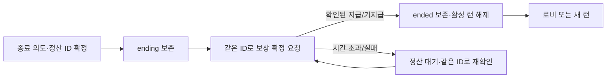

# 체스 알까기 기물 역할과 전략성 및 재도전 개선 기획서

2026-11-15 · 기획 기준 v1.0 / 로컬 1차 구현 기록 추가 · 공개 출시 전

- 원안: [기물 역할과 전략성 및 재도전 개선 제안서](체스%20알까기%20기물%20역할과%20전략성%20및%20재도전%20개선%20제안서_2026-11-15.md)
- 실행 기준: [개발·QA 체크리스트](체스%20알까기%20기물%20역할과%20전략성%20및%20재도전%20개선%20QA%20체크리스트_2026-11-15.md)
- 조사 버전: develop `f60143438870eefb2a28b6d3bf2a4fb8b899dabc`. 댓글의 실행 빌드는 미상이며 현재 소스와 같다고 가정하지 않는다.

**제품 목표:** 실패한 판을 배워서 다시 도전할 수 있게 하고, 말·힘·위치 선택의 차이를 만든다. 래그돌과 당겨서 놓는 조작, 진행에 따른 성장감은 유지한다.

문서의 ‘기획 결정’은 이번 개발 기준 작성안이다. 게임 구현이나 사용자 검수 완료를 뜻하지 않는다. 제안서의 `SG-R01~06`, `SG-T01~12`를 이어 쓰며, 새 QA는 모두 미실행으로 시작한다.

## 1. 출시 범위와 우선순위

| 구분 | 포함 내용 | 완료 기준 |
|---|---|---|
| 1차 제품 구현 | SG-R01 현재 단계 재도전·경계 저장·중복 없는 정산, SG-R06 사실 기반 결과 안내 | 저장·정산·복구 핵심 QA 통과 후 검수 대상 빌드 생성 |
| 2차 개발용 실험 | SG-R02 지상 발사 위력·폰 효율, SG-R03 기물 역할 | 아래 비교 설정으로 효과를 측정. 채택 전 공개 기본값 변경 없음 |
| 후속 규칙 실험 | SG-R04 킹 목표, SG-R05 카드 구조 | 별도 규칙 버전·비교 결과와 수용 판단 필요 |

첫 제품 적용 조건은 **`PLATFORM.id === "itch"`의 일반 `stage`**다. 게스트와 로그인 사용자를 포함하되 계정 보상 정산의 내구성까지 검증해야 한다. CrazyGames와 같은 `solo` 기능을 공유한다는 이유로 함께 켜지 않는다.

온라인·주간 도전·퍼즐·튜토리얼·2인 대전, 일반 웹·Android·다른 포털은 동작 보존과 공통 함수 회귀 검사 대상이다. 전체 배포 확대나 AAB 제작은 이 문서의 작성만으로 실행하지 않는다.

### 보존할 기능

- 당긴 거리로 힘을 정하고 놓으면 발사하는 조작, 정밀 조준 설정과 보드 확대를 유지한다.
- 현재 나이트 AI 개선과 공통 발사 계산을 기준으로 삼는다. 충돌 후 생존을 보장하는 기능으로 표시하지 않는다.
- 영구 연구·최고 클리어 단계·해금·보유 재화·계정 소유권을 보존한다.
- 1차에서는 기물 파워·중량·반발·마찰, 승리 조건, 카드 효과·개수, 적 단계별 강화와 조준 오차를 바꾸지 않는다.

## 2. 현재 동작과 변경점

| 항목 | 현재 확인 | 1차 목표 |
|---|---|---|
| 패배 | 런 종료, solo 체크포인트 삭제, 누적 포인트 정산 | 같은 단계·런 카드·임시 포인트 유지. 다시 도전 가능 |
| 무승부 | solo는 같은 단계와 카드로 재경기 가능 | 기존 보존 동작 유지, 결과/버튼을 패배 재도전과 일관되게 정리 |
| 메뉴로 이동 | 경로에 따라 종료/복귀 의미가 다름 | 중단·보존으로 통일. 정산 종료와 구분 |
| 새로고침 | 단계 시작 체크포인트 복원 | 단계 시작·결과·카드 선택 대기·선택 확정 후 준비 상태를 구분해 복원 |
| 카드 선택 직전 | 별도 대기 상태를 저장하지 않음 | 같은 제안과 선택 여부 복원, 이미 클리어한 판의 재클리어/중복 선택 방지 |
| 새 런 | 해금된 단계에서 시작 가능, 기존 런 카드 초기화 | 기존 런이 있으면 종료·정산 확인 후 새 런 생성 |
| 저장 실패 | 기존 쓰기 함수가 실패를 안내하고 반환함 | 메모리 진행과 디스크 저장 성공을 구분해 UI에 반영 |

`메뉴로`는 도전을 포기하는 행동이 아니다. 명시적으로 `도전 종료하고 정산`을 선택할 때만 런을 종료한다. 이 구분은 결과 화면, 경기 메뉴, 로비의 새 런 시작에 공통 적용한다.

## 3. SG-R01 — 재도전 규칙

### R01-A. 유지·초기화 대상

| 유지 | 단계 시작 상태로 다시 생성 | 복원하지 않음 |
|---|---|---|
| 런 ID, 시작/현재 단계, 확정 카드 상태·선택 횟수, 직전 클리어 단계·미정산 포인트, 규칙/배치 버전 | 양 진영 말의 구성·위치·자세, 벽·구멍·기믹, 킹 특수 능력 사용권, 승격 대기·턴·AI 샷 카운터 | 패배 직전 물리 위치·속도, 진행 중 샷, 충전 조준·선택 표시·예약 AI 발사 |

재도전 횟수는 제한하지 않는다. 패배·무승부·재도전은 카드 추첨, 추가 강화, 클리어 보상, 해금 증가를 발생시키지 않는다. 거대 폰·포복 개시는 저장된 활성 상태로 시작 구성을 다시 만들며 재도전 때 중복 적용하지 않는다.

영구 연구는 현재 소유자의 보유 상태를 사용한다. 중단 중 정당하게 구입한 연구를 과거 체크포인트로 취소하지 않는다. 전후 밸런스 비교 시험에서는 영구 연구를 고정한다.

### R01-B. 결과별 전이

| 사건 | 다음 상태 | 포인트·카드 처리 | 기본 행동 |
|---|---|---|---|
| 패배 | `stage-result:loss` | 클리어 단계·카드·임시 포인트 불변, 지급 없음 | 같은 단계 다시 도전 |
| 무승부 | `stage-result:draw` | 동일, 지급 없음 | 같은 단계 다시 도전 |
| 1~9단계 승리 | `awaiting-card` | 해당 단계 클리어 한 번 확정, 최고 단계 갱신, 같은 카드 제안 저장 | 카드 하나 선택 |
| 카드 선택 확정 | `preparing-stage` | 선택 카드 한 번 적용, 목표 단계 확정 | 다음 단계 준비 |
| 다음 보드 준비 성공 | `stage-ready` | 확정 상태 그대로 | 경기 시작 |
| 10단계 승리 | `ending:completed` | 10단계 클리어 포함 정산 한 번 요청 | 완주 결과 |
| 메뉴로 | 현재 경계 상태 유지 | 정산·초기화 없음 | 로비에서 이어하기 |
| 명시적 종료 확인 | `ending:user-ended` | 이미 클리어한 단계 기여분만 정산 | 완료 후 로비 |

최고 클리어 단계 저장과 보상 지급은 구분한다. 해금이 올라갔다고 계정 포인트가 이미 지급됐다는 뜻은 아니다. 샷 도중 창을 닫으면 그 샷은 복원하지 않고 해당 단계 시작으로 돌아간다.

## 4. 저장 상태와 복구 계약

아래는 필요한 의미를 정의한다. 기존 저장 어댑터를 확장해 충족하며 별도의 전투 스냅샷 엔진을 만들지 않는다.

| 필드 묶음 | 필요한 값/역할 |
|---|---|
| 식별 | 스키마 버전, 소유자 구분, 플랫폼, `runId`, `revision` |
| 규칙 | 제품 규칙 ID, 밸런스/배치 버전, 런 시작 단계 |
| 경계 상태 | `stage-ready`, `stage-result`, `awaiting-card`, `preparing-stage`, `ending`, `ended` |
| 진행 | 현재/목표 단계, 마지막 클리어 단계, 런 카드 등급·특수 상태·선택 횟수 |
| 카드 제안 | 클리어 단계, `offerId`, 후보 ID, 확정 선택 ID. 재로드 때 다시 추첨하지 않음 |
| 결과 | 패배/무승부와 해당 결과의 사실 요약. 물리 월드·동영상은 저장하지 않음 |
| 정산 | 안정적인 `settlementId`, 종료 사유, 시작/최종 클리어 단계, 산정 버전, 지급 확인 상태 |

`revision`은 오래된 비동기 콜백이나 이전 화면이 최신 상태를 덮어쓰지 않게 하는 비교값이다. 무조건 증가시킨다고 여러 탭의 동시 저장 문제가 해결되는 것은 아니다.

정산 ID는 런 ID에서 일관되게 찾을 수 있어야 한다. 재개 시 해당 런의 정산 영수증도 대조하며, 이미 지급된 런이면 오래된 `stage-ready` 저장이 남아 있어도 `ended`로 복구한다. 계정에서 확인할 수 없는 상태는 지급 여부 미확인으로 표시하고 재확인을 제공한다. 지급된 런을 새 활성 런처럼 이어서 진행시키지 않는다.

### 상태별 유효성

`b`를 런 시작 단계, `s`를 현재 클리어/진행 단계로 한다. 1~10단계 범위를 검증하고, 일반 카드 등급 합과 선택한 특수 카드 수는 전체 선택 횟수와 일치해야 한다.

| 상태 | 마지막 클리어 단계 | 카드 선택 횟수 | 재개 화면 |
|---|---:|---:|---|
| `stage-ready` / 패배·무승부 결과 | `s-1` | `s-b` | 단계 시작 / 보존된 결과 화면 |
| `awaiting-card` (s≤9) | `s` | `s-b` | 저장된 카드 제안 |
| `preparing-stage` (목표 s+1) | `s` | `s+1-b` | 확정한 카드로 다음 단계 준비 |
| 완주 정산 | `10` | `10-b` | 정산 상태에 맞는 완주 화면 |

1. 승리는 클리어 상태와 카드 제안을 메모리의 한 전이로 확정한다. 같은 `runId + stage` 결과를 재통지해도 클리어·보상 요청을 다시 만들지 않는다.
2. 선택은 현재 제안에 속한 카드만 받는다. 확정 선택을 먼저 보존하고 다음 보드를 준비한다. 준비 실패 시 확정된 `preparing-stage`를 유지한다. 카드 선택 화면으로 돌아가 재적용하지 않는다.
3. 준비 성공 후 `stage-ready` 저장이 실패해도 기존 `preparing-stage`로 같은 카드를 가진 보드를 다시 만들 수 있어야 한다. 실패 메시지는 저장 실패와 보드 준비 실패를 구분한다.
4. 결과/중단에서 재도전하면 해당 경계의 보드를 다시 만든 뒤에만 결과 오버레이와 입력 잠금을 해제한다. 생성 실패 시 기존 결과와 복구 버튼을 유지한다.
5. 계정 변경 시 이전 소유자의 콜백·진행·정산 요청을 현재 계정에 적용하지 않는다. 다른 소유자의 저장은 삭제하지 않는다.
6. 같은 저장을 두 탭에서 여는 경우 한 탭만 진행을 확정할 수 있게 한다. 충돌을 발견한 탭은 발사·카드 선택·정산을 멈추고 최신 진행을 다시 읽는 행동을 제공한다. 단순한 마지막 쓰기 우선으로 카드·포인트를 병합하지 않는다. 미지원 환경은 두 번째 탭의 진행을 허용하지 않는다.

샷 진행 중 메뉴로 중단하면 마지막 확정 경계를 유지한다. 이미 승리를 확정했다면 카드 대기 상태를 보존한다. 떠난 보드에서 늦게 도착한 결과는 보드 세대·시도 식별자로 차단하여 중단한 런을 뒤늦게 클리어하거나 다음 런을 변경하지 않는다.

### 저장 실패와 이전 데이터

- 저장 API는 호출 성공과 실패를 호출자에게 반환해야 한다. 기존 `writeSoloCheckpoint`처럼 내부에서 예외를 소비하는 것만으로 저장 완료를 표시하지 않는다.
- 저장 불가 시 현재 탭의 메모리 상태로 재도전은 계속할 수 있다. `이 창에서는 계속할 수 있지만, 닫으면 진행을 이어갈 수 없습니다.`를 기존 저장 안내 영역에 표시한다. 저장 성공 문구를 함께 표시하지 않는다.
- 새로고침 후 디스크의 마지막 유효 경계로 돌아갈 수 있음을 알린다. 실제로 저장되지 않은 선택/승리를 보존한다고 약속하지 않는다.
- 저장 장애 중에도 카드 선택은 현재 메모리 상태에서 한 번만 확정할 수 있다. 보드 준비를 재시도해도 재적용하지 않는다. 이때 진행은 세션 한정이며, 디스크의 이전 `awaiting-card`가 남아 있으면 새로고침 때 그 경계로 돌아갈 수 있음을 명시한다. 영속 정산은 별도 성공 확인 전 완료로 표시하지 않는다.
- 유효한 v2 체크포인트는 소유자·카드·단계 불변식을 검증한 뒤 `stage-ready`로 이전한다. 당시 `metaPoints`를 현재 계정 잔액으로 쓰지 않는다. 기존 잔액 불일치만으로 런을 버리지 않는다.
- 이전할 런 ID는 한 번 확정한다. 이전 저장 실패 때마다 새 ID로 계정 보상을 요청하지 않는다. 이전 완료를 확정할 수 없다면 새 형식의 지급 전이를 잠그고 원본 보존·재시도 경로를 사용한다.
- v2에는 ‘클리어 후 카드 대기’ 정보가 없으므로 이미 보여줬던 카드 화면을 추정 복원하지 않는다. 저장된 단계 시작으로 복귀한다는 일회성 안내를 제공한다.
- 손상·미지원 버전은 원본을 보존하고, 기존 해금·연구·재화로 새 런을 시작하는 경로를 제공한다. 카드/밸런스 버전이 달라졌다면 호환 변환이 확인된 경우만 복원하고, 불가능하면 진행을 잇지 못하는 이유를 명시한다.

## 5. 정산과 보상 처리

### 기획 결정

- 패배·무승부·메뉴 복귀에서는 임시 런 포인트를 지급하지 않는다. 명시적 종료와 완주에서만 정산한다.
- 정산액은 기존 단계 기여식 `computeStageRunPayout(lastClearedStage) - computeStageRunPayout(startStage - 1)`를 사용한다. 해금된 4단계에서 시작한 런은 1~3단계 기여를 지급하지 않는다.
- `도전 종료하고 정산`은 기존 수동 포기의 ‘임시 포인트 폐기’를 대체한다. 이는 대상 itch 일반 스테이지의 기획 변경이며 다른 모드에는 적용하지 않는다.
- 클리어에 의존하는 보상·승리 퀘스트·숙련·배너는 논리적인 `runId + stage + 보상 종류`에 연결한다. 결과 재전달마다 다른 이벤트 ID를 생성하지 않는다. 기존 소유권·유효성 검사를 우회하지 않는다.
- 발사 횟수처럼 실제 행동을 세는 기존 퀘스트는 승인된 샷마다 집계한다. 재도전에서 새로 발사한 샷까지 이전 샷의 중복으로 버리지 않는다. 보드 시도 식별자/샷 순번은 클리어 보상 ID와 구분하며, 취소·거절된 입력과 이전 보드의 지연 통지는 새 행동으로 집계하지 않는다.

### 반드시 지킬 정산 순서



지급 후 `ended` 저장 전에 창이 닫혀도 동일 ID를 재확인하면 금액이 다시 더해지지 않아야 한다. 응답 유실을 지급 실패로 단정하거나, 재시도 때 새 정산 ID를 만들지 않는다.

| 경로 | 구현이 충족할 계약 |
|---|---|
| 게스트 | 현재 재화와 같은 저장 단위에 정산 영수증을 함께 확정. 재화만 쓰고 별도 키에 ‘지급됨’을 뒤늦게 쓰는 방식은 불가. 저장 불가 시 영속 정산 완료로 표시하지 않음 |
| 로그인 계정 | 기존 서버 권한/저장 경로에 소유자별 중복 정산 거부와 확인 응답 필요. 로컬 카드 체크포인트나 캐시 변경을 서버 지급 영수증으로 사용하지 않음 |
| 종료 준비 실패 | 종료 전의 진행/카드 유지. 이미 확정한 카드·포인트를 지우지 않음 |
| 지급 확인 대기 | 로비 복귀는 허용하되 `정산 확인 중` 상태 보존. 완료 확인 전 새 런 시작·연구 구매로 미확정 재화를 사용하지 않음. 같은 정산 재확인 가능 |
| 새 런 보드 준비 실패 | 기존 런 정산을 취소·재지급하지 않음. 새 런 시작만 재시도하고 이전 도전을 살린 척하지 않음 |

현재 계정 저장은 리비전 비교를 사용하는 스냅샷 저장이며 **솔로 런 정산 영수증과 잔액 가산 RPC가 없다**. 그 계약 보완은 로그인 계정을 포함하는 1차 구현의 선행 작업이다. 계정 정산은 인증된 소유자, 동일 런의 고정 정산 ID, 규칙 버전, 시작/마지막 클리어 단계로 요청하며 서버가 유효 범위와 금액을 산정한다. 같은 ID·같은 내용은 같은 영수증을 반환하고, 같은 ID·다른 내용은 충돌로 거절한다.

지급 전 미확정 영구 진행 쓰기는 기존 동기화로 정리하고, 지급 후에는 서버의 잔액·리비전을 현재 캐시의 기준으로 반영한다. 오래된 캐시의 자동 저장이 정산액이나 동시에 처리한 연구 구매·튜토리얼 지급을 덮어쓰지 않아야 한다. 게스트는 기존 메타 리더가 미등록 키를 거부하므로 영수증 필드를 구형 키에 임의 추가하지 않고, 버전 있는 읽기/쓰기·이전 규약을 함께 바꾼다. 여러 탭의 read-modify-write는 실제 잠금/트랜잭션으로 직렬화하거나 추가 탭의 진행을 차단한다. `storage` 이벤트만으로 잠금이 보장된다고 보지 않는다.

프런트엔드의 버튼 잠금만으로 출시 조건을 충족했다고 보지 않는다. 여기서 요구하는 것은 정산 중복 방지이며, 클라이언트의 물리 승리를 서버가 증명하거나 게스트 저장 조작을 막는 새 안티치트 시스템은 아니다.

## 6. 화면·행동 명세

기존 결과 오버레이·카드 영역·로비 구조를 재사용한다. 아래는 신규 상태의 **구조·문구 명세**이며 실제 캡처나 확정 미술 시안이 아니다.

### 화면 S01 — 패배/무승부 결과

```text
┌─────────────────────────────────────────┐
│ 4단계 · 패배                            │
│ 이번 샷: 내 말 1개 · 상대 말 0개 장외   │
│ 4단계와 선택한 강화는 유지됩니다.       │
│ 누적 연구 포인트: {미정산액} · 미정산   │
│                                         │
│ [4단계 다시 도전]       [메뉴로]        │
└─────────────────────────────────────────┘
```

| 상태 | 제목/본문 | 행동 |
|---|---|---|
| 패배 | `{s}단계 · 패배` / `{s}단계와 선택한 강화는 유지됩니다.` | 주 행동 `{s}단계 다시 도전`, 보조 `메뉴로` |
| 무승부 | `{s}단계 · 무승부` / `동시 탈락했습니다. 현재 단계와 강화는 유지됩니다.` | 동일 |
| 재도전 처리 중 | `경기 준비 중…` | 양 버튼 잠금, 성공 후 보드 입력 허용 |
| 보드 준비 실패 | `경기를 준비하지 못했습니다. 다시 시도할 수 있습니다.` | 같은 단계 재시도·메뉴 복귀 가능 |
| 저장 불가 | 별도 저장 상태 안내 | 메모리 재도전 허용, 브라우저 재개 보장 문구 제외 |

`메뉴로`는 확인창 없이 보존 상태로 로비에 이동한다. Esc/뒤로가기도 이 행동과 동일하다. 주 행동으로 포커스를 보내고, 상태 변경 메시지는 기존 접근성 상태 영역에서 전달한다.

### 화면 S02 — 로비 이어하기/종료

진행 중 런이 있으면 기존 스테이지 영역에 `이어하기 · {s}단계`를 표시한다. 카드 선택 대기 상태라면 `이어하기 · 강화 선택`, 정산 대기 상태라면 `정산 확인`을 표시한다. UI를 실제 상태와 다르게 표시하지 않는다.

경기 메뉴의 종료 행동은 `도전 종료하고 정산`으로 명시한다. 결과 화면에 세 번째 큰 버튼을 추가하지 않는다. 다른 단계의 새 런을 고르거나 새 시작을 요청하면 다음 확인을 사용한다.

```text
현재 도전을 종료할까요?
클리어한 단계까지의 {포인트}를 정산합니다.
현재 런의 강화는 새 도전에 이어지지 않습니다.
[계속하기]  [종료하고 정산]
```

새 런 요청에서 진입했다면 종료·지급 확인 후 선택한 단계의 새 런을 시작한다. 취소/Esc는 원래 화면으로 돌아가며 상태를 변경하지 않는다. 확인 버튼 연타·지연 응답으로 종료를 두 번 수행하지 않는다.

### 화면 S03 — 카드/준비/정산 복구

| 상황 | 표시/행동 |
|---|---|
| 카드 선택 대기로 복귀 | 저장된 동일 카드와 전후 효과 표시. 새로운 추첨 없음 |
| 선택 확정 후 보드 준비 실패 | `강화 선택은 반영됐습니다. 다음 경기를 다시 준비합니다.` / `다시 준비` |
| 저장 실패 | `진행을 이 브라우저에 저장하지 못했습니다.` / 메모리 진행 가능 여부와 닫을 때 손실 안내 |
| 정산 응답 불명 | `정산 결과를 확인하고 있습니다.` / `다시 확인`, `메뉴로` |
| 정산 확인 완료 | 확정된 획득액 표시, 활성 도전 종료, 새 시작 가능 |

모든 문구는 기존 지원 언어의 번역 키를 사용하고 한국어/영어 예시만 하드코딩해 출시하지 않는다. 390×844 세로, 844×390 가로, 1366×768에서 기존 영역 내 줄바꿈·스크롤을 허용한다. 키보드 초점·터치 영역·동작 줄이기 설정을 보존한다.

## 7. SG-R06 — 결과 원인 안내

1. 최종 승패는 실제 정착·장외 제거 결과로 정한다. 기본 전멸 승패는 유지하며 무승부를 플레이어 승리로 바꾸지 않는다.
2. 직전 샷의 실제 제거 목록에서 내 말/상대 말 장외 수를 집계한다. 지연된 낙하도 같은 샷의 정착에 속하면 포함한다. AI가 발사한 샷이라면 그 사실을 구분할 수 있어야 한다.
3. 직전 샷 증거가 없는 종료에서는 장외 원인을 추정하지 않고 `남은 말: 내 말 {a}개 · 상대 말 {b}개`를 사용한다. 취소된 입력·이전 경기 로그를 현재 결과로 쓰지 않는다.
4. 강제 정착은 개발 기록에 별도 표시하고, 결과 증거가 있는 경우에만 추가 설명을 제공한다. 공중 안내를 정확한 최종 착지점이나 승률로 표시하지 않는다.
5. 플레이어용 화면에는 위치 좌표·물리 해시·프레임 번호 등 개발 정보를 노출하지 않는다. 상세 원인 실험은 개발 기록에서 수행한다.

## 8. SG-R02·03 — 위력과 기물 역할의 개발용 실험

### 실험 설정과 채택 절차

| 실험 ID | 기준 | 비교 값 | 나머지 조건 |
|---|---|---|---|
| SG-E01 | itch 일반 스테이지의 지상 기본 속도 11 | 9 / 8 | 나이트 기본 속도·65도·최소 보정, 마찰·반발·카드·적 버프·조준 오차 고정 |
| SG-E02 | 폰 속도 배율 1.0 | 0.85 / 0.70 | E01 채택/보존값을 고정한 뒤 폰만 변경. 수량·질량·승격 규칙 고정 |
| SG-E03 | 현재 반발 0.6·추가 감쇠 0 | 재현 원인에 해당하는 한 값만 별도 실험 | E01/E02와 동시 조정 금지. 후보는 실험 기록에 먼저 지정 |
| SG-E04 | 룩/퀸의 기존 150% 조건 | 각각 보존 또는 축소 비교 | 기물별 별도 실행. 기본 속도 변화 뒤 오버드라이브도 측정 |

개발용 설정은 플레이어 메뉴에 새 모드로 노출하지 않는다. 공통 `MAX_LAUNCH_SPEED`를 전역 변경해 다른 플랫폼이나 나이트가 함께 바뀌는 구현은 허용하지 않는다. 제품 기본 프로필은 검수 전까지 현행값을 유지한다.

기준과 후보는 동일한 시작 상태·물리 스텝·파워·방향·타격점을 비교한다. 기본 샷 파워는 30%·60%·100%, 룩/퀸은 유효한 150%도 추가한다. 고정 배치는 중앙/네 가장자리·가까운/먼 적·군집/분산·아군 방해·벽/구멍·서거나 누운 말을 포함해 구성하고 배치 파일/해시를 저장한다.

필수 지표는 접촉, 상대/자기 장외, 상대 장외+자기 생존, 동시 전멸, 정착 시간/강제 정착, 폰의 승격 도달이다. 파워를 줄여 접촉 자체가 어려워진 결과를 전략성 개선으로 세지 않는다. 군집을 노린 의도적 연쇄는 보존하며, 분산된 적에게 최대 파워를 난사하는 선택과 구분한다.

**후보 채택:** 기준보다 중간 파워의 상대 장외+자기 생존 선택이 늘고, 기존에 가능한 합법 공격/승격을 사실상 없애지 않으며, 사람 과제에서도 파워 선택 이유를 설명할 수 있어야 한다. 초기 측정 후 정한 허용 손실 기준을 후보 적용 전에 기록한다. 효과가 불명확하거나 핵심 접근성이 악화되면 현행값을 유지한다. 고정 샷 결과와 사람의 재미 평가는 각각 보고한다.

### 역할별 목표와 비채택 항목

| 기물 | 역할/검증 과제 | 이번에 바로 확정하지 않는 변경 |
|---|---|---|
| 폰 | 가까운 적 밀기·길 막기·승격. 다른 말과 동일 배치 교환 효율 비교 | 무조건 50% 제한, 수량/질량 동시 약화 |
| 킹 | 기존 1회 교대 또는 방어의 발견·사용·생존 효과. 킹만 남아도 합법 행동 보장 | 공격 삭제, 무게 증가만으로 방어 전용이라고 판단 |
| 퀸 | 강한 공격·회전과 자기 위험의 선택 | 생존까지 모든 말보다 우월한 상위 호환 |
| 룩 | 중앙 타격·직선 압박·길 막기의 차이 | 새 고정/무적 특성부터 추가 |
| 비숍 | 기존 회전·굴절의 효용과 방향 선택 | 현행 특성에 대각선 보너스를 즉시 중첩 |
| 나이트 | 장애물을 넘는 선택과 최소 도약/착지 자기 장외 | AI 전용 물리 보정, 최근 후보 AI를 정착 예측으로 광고 |

비숍 대각선 보너스는 후속 SG-E05로만 비교한다. 보드 대각선 기준 ±12도, 속도 +10%는 초기 후보이며 채택값이 아니다. 카메라 회전과 AI 최종 오차를 반영한 실제 발사 방향으로 판정하고 안내와 속도 계산을 공유한다. 대각선 외 발사 금지는 추가하지 않는다.

## 9. SG-R04 — 킹 목표 규칙 실험

SG-E06은 재도전 기반과 지상 위력 평가가 끝난 뒤 실시한다. 지정 킹이 양쪽에 하나씩 있는 소수 고정 배치에서 기존 전멸 규칙과 비교하며, 새 규칙 ID를 사용한다.

- 지정 킹의 장외를 샷의 정착/장외 제거 완료 후 확인한다. 양쪽 지정 킹이 같은 샷에 탈락하면 무승부다. 콜백 순서로 승자를 정하지 않는다.
- 목표 ID는 시작 시 고정하며 교대해도 유지한다. 잘못된 복수 목표를 가진 배치는 시작 전에 거부한다.
- 킹 없는 1~3단계는 처음부터 기존 전멸 목표다. 경기 중 킹이 사라졌다는 이유로 목표를 전환하지 않는다.
- 현재 승격 후보에는 킹이 없다. 목표 종료 시 남은 승격·충전·AI 예약을 정리한다. 다른 기물이 퀸으로 승격해도 지정 킹의 생명/목표를 대체하지 않는다.
- AI는 자신의 킹 노출과 상대 킹 공격을 고려해야 한다. 전멸 목표 AI를 그대로 사용하는 비교 결과를 새 전략성의 검증으로 보지 않는다.
- 채택 판단은 킹 보호·위치 선정·공격 전환이 생겼는지, 우연한 초반 즉사·방어 정체가 늘었는지를 함께 본다. 미검증이면 공개 기본 규칙은 전멸 유지다.

## 10. SG-R05 — 카드 유지·수정·제거 비교

1차 제품에는 현행 추첨·효과·선택 개수를 유지한다. 카드 선택 대기의 저장과 실제 적용 상태만 바로잡는다. 카드 삭제나 수치 일괄 증폭은 1차 범위가 아니다.

SG-E07은 현행 카드 / 기존 효과와 다음 판 적용을 명확히 한 카드 / 카드 없는 고정 성장 조건을 비교한다. 영구 연구와 적 강화·초기 구성·배치를 맞추고, 카드 없는 조건이 단지 더 쉽거나 어려워서 선호된 경우를 분리한다. 동시에 기물 역할이나 킹 목표를 바꾸지 않는다.

관찰 과제는 카드 선택 이유, 전후 효과 설명, 다음 샷/기물 선택의 변화, 특수 카드의 이득·불이익, 다시 플레이할 의향이다. 선택지 수를 늘리는 것으로 전략성을 증명하지 않는다. 비교 결과로 일반 스테이지의 카드 변경을 별도 결정하며, 영구 연구·기존 해금·주간 카드 규칙은 자동 삭제하지 않는다.

## 11. 개발 작업과 완료 조건

| 순서 | 작업 | 검토할 위치 | 산출/완료 조건 |
|---|---|---|---|
| 1 | 저장·정산 계약 확인 | `crazygames-solo.ts`, `progress-storage.ts`, `meta.ts`, 계정 보상 RPC | 상태별 검증, 소유권, 지급 영수증·응답 유실 재확인 방법 확정 |
| 2 | 상태 전이와 기존 저장 이전 | `main.ts` 모드 전환·결과·카드 콜백 | 패배/메뉴가 런을 지우지 않음. 카드·준비·종료 복구 가능 |
| 3 | 결과/로비/종료 확인 연결 | `match.ts`, 메뉴와 저장 안내 | S01~03 모든 행동이 실제 상태와 일치, 중복 입력/뒤로가기 처리 |
| 4 | 사실 요약과 초기화 점검 | `turn.ts` 결과 증거, `ai.ts`, 입력/카메라 초기화 | 이전 판의 샷/승격/AI/선택 표시가 재도전에 남지 않음 |
| 5 | 핵심·회귀·사람 과제 검증 | 연결 체크리스트 | 아래 출시 조건 충족, 남은 실험과 결과 구분 |
| 6 | E01부터 단일 요인 실험 | 공통 발사·밸런스·배치·측정 도구 | 후보별 결과표와 채택/유지 사유. 채택 전 공개 기본값 불변 |

1차 출시 조건은 저장/복구/정산의 실패·응답 유실·연타·소유자 변경 케이스 통과, 다른 모드/플랫폼 비영향, 지원 언어·뷰포트·키보드 동작 확인이다. 정산 확인에 필요한 서버 기능이나 다중 탭 보호가 빠져 있다면 구현 완료로 표시하지 않는다.

게임 실행·물리·재화 갱신 검사는 구현 이후 실행한다. 이 문서를 작성하면서 새 기능의 동작이나 밸런스를 통과 처리하지 않는다. 결과 보고서는 구현 상태, QA 결과, 사람 체감, 미검증 기기, 배포 여부를 나눠 기록한다.

저장·정산 기술 검토 근거: [현재 저장 기능과 필요한 계약](../qa/strategy-progression-prd-2026-11-15/storage-settlement-review.md). 이 자료도 소스 조사이며 구현/런타임 증거가 아니다.

## 12. 2026-11-15 개발 실행 기록

1차 제품 범위 SG-R01과 SG-R06의 사실 기반 결과 UI를 로컬 구현했다. 재도전/메뉴 중단, 카드 경계 저장, 준비 실패 재시도, 명시적 종료·게스트/계정 영수증 정산, 소유자·탭 보호를 연결했다. [구현·검증 보고서](../qa/strategy-progression-implementation-2026-11-15/RESULT-ko.md)와 기존 QA 체크리스트 v1.1에 실제 실행 범위와 남은 검수를 기록했다. v1.0 본문의 목표·수용 조건은 유지한다.

로컬 자동 검사·3개 뷰포트의 통제된 결과 흐름·오류 주입·itch/웹 빌드와 산출물 진입 검사를 실행했다. 실제 서버 migration 적용/로그인 계정 E2E, 상세 샷 기록·반복 민감도 과제, 전체 언어/키보드·사람 검수는 아직 완료하지 않았다. 위력·기물 역할·킹 목표·카드 구조 18개 비교 실험은 후속 단계이며 기본값은 현행을 보존했다. 이 기록은 공개 출시 승인이나 AAB·푸시·업로드 완료를 뜻하지 않는다.

## 13. 2026-11-15 2차 개발 실험 실행 기록

사용자 요청으로 후속 킹 목표/카드 구조는 제외하고 SG-R02/03 개발용 비교를 실행했다. E01 지상 9/8, E02 폰 0.85/0.70, E04 룩/퀸 초과 위력, E05 비숍 대각선 후보를 명시적 로컬 실행에서만 적용한다. E03은 재현 원인 미확정으로 보류한다.

13개 배치·6종 기물·8개 프로필의 2470회 실제 물리 샷과 보존 검사, 브라우저 진입을 확인했다. 속도 8은 중간 세기 안전 성공 이득과 직접 접촉 손실을 함께 보여 QA 비교 대상으로 남겼다. 공개 기본값은 현행 유지다. [2차 결과/한계](../qa/strategy-experiments-2026-11-15/RESULT-ko.md)와 [Orca QA 요청](../qa/strategy-experiments-2026-11-15/QA-HANDOFF-ko.md)을 참조한다.

이 실행 기록은 실제 사람의 재미 검증, 후보 채택, 후속 규칙 구현, 게시 또는 운영 DB 적용 완료를 뜻하지 않는다.
