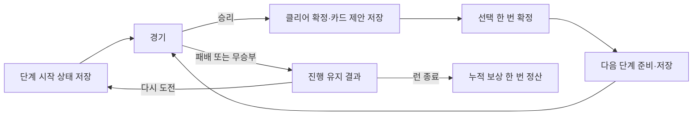

# 체스 알까기 기물 역할과 전략성 및 재도전 개선 제안서

2026-11-15 · v1.0 · 제안 단계 · 소스 조사 기준: develop `f60143438870eefb2a28b6d3bf2a4fb8b899dabc`

> 후속 문서: [개발 기획서 v1.0](체스%20알까기%20기물%20역할과%20전략성%20및%20재도전%20개선%20기획서_2026-11-15.md)와 [개발·QA 체크리스트](체스%20알까기%20기물%20역할과%20전략성%20및%20재도전%20개선%20QA%20체크리스트_2026-11-15.md)에 구현 범위·상태·화면·검증 기준을 구체화했다. 아래 제안의 배경과 실험 후보는 원안으로 보존한다.

**권장 방향은 ‘실패한 판은 다시 도전할 수 있고, 어떤 말로 누구를 노릴지에 따라 결과가 달라지는 알까기’다.** 먼저 패배로 진행을 잃는 부담을 줄이고, 최대 파워에 치우친 전투와 기물 역할을 하나씩 조정한다. 킹 탈락 승리 조건과 카드 제거는 비교 실험으로 판단한다.

이 문서는 구현 가능한 개선안을 제시한다. 아래 수치는 시험 후보이며 확정 밸런스가 아니다. 이번 작업에서는 게임 소스·저장 데이터·배포를 변경하지 않는다.

## 1. 피드백을 어떻게 해석할 것인가

근거는 사용자가 전달한 긴 댓글 한 건과 이전 기물·나이트 관련 댓글이다. 이번 댓글 작성자의 빌드·모드·입력 기기·강화 상태·플레이 시간은 알려져 있지 않다. 댓글의 주장 전체가 최신 빌드에서 재현됐다고 보지 않는다.

| 피드백 | 해결하려는 문제 | 그대로 적용하기 전 확인할 점 |
|---|---|---|
| 폰이 가장 좋고 나머지는 비슷함 | 기물 선택의 손익이 잘 드러나지 않음 | 폰의 실제 효율인지, 수량·조작 용이성·강화 조합의 영향인지 구분 |
| 나이트가 나쁨 | 도약·착지 결과와 자기 장외를 납득하기 어려움 | develop의 최근 AI 수정과 댓글 당시 빌드는 같다고 가정할 수 없음 |
| 체스 말로 볼링을 하는 느낌 | 강한 샷 외에 보호·위치 선정·교환의 의미가 약함 | 큰 위력과 연쇄 충돌의 재미까지 없애지 않기 |
| 킹이 죽으면 끝내자 | 집중해서 보호하고 공격할 목표가 필요함 | 킹 없는 입문 배치, 양쪽 킹 동시 탈락, 목표 킹 식별과 승격 처리 우선순위 |
| 패배 초기화와 무승부가 성가심 | 불확실한 결과의 손실이 커서 재도전 의욕이 떨어짐 | 현재 모드별 이어하기·정산 규칙이 다름 |
| 성장은 좋지만 카드가 별로임 | 성장감은 있으나 개별 선택의 효과와 필요성이 약함 | 성장 전체를 제거하라는 뜻으로 확대하지 않기 |

**가장 먼저 풀 문제는 ‘전략이 없다’는 평가 자체보다, 강하게 쏘는 선택이 얼마나 자주 다른 선택보다 유리한가와 실패 후 얼마나 많이 잃는가다.**

## 2. 현재 구현에서 확인한 사실

다음은 로컬 소스와 과거 검사 기록이다. 이번 제안서 작성 중 새 플레이 시험을 실행한 결과는 아니다.

| 대상 | 확인한 사실 | 기획에 주는 의미 |
|---|---|---|
| 기본 발사 | 온라인 이외 기본 최대 속도 11, 온라인 일반 기물 7·나이트 4.5. CSV 기물별 파워 배율은 모두 1 | 오프라인 파워 실험을 온라인까지 일괄 적용하면 안 됨 |
| 무게와 발사 | 실제 충격량은 질량 × 목표 속도. 무거워져도 같은 입력의 목표 초기 속도는 유지됨 | 킹 무게만 올리면 공격이 사라지지 않음. 방어·공격을 함께 측정해야 함 |
| 폰 | 기본 파워 배율 1. 나머지 기물과 동일한 능력치라는 뜻은 아님 | ‘폰이 압도적’이라는 체감은 별도 비교가 필요 |
| 특수성 | 룩 중앙 타격·퀸의 일부 발사는 150% 가능. 비숍 회전/굴절, 나이트 도약, 킹 교대/방어가 이미 있음 | 특수 능력을 새로 만든다고 기획하기 전에 실제 발견·사용·결과를 확인 |
| 기본 승패 | 정착·장외 제거 후 한 진영의 말이 모두 사라지면 패배, 양쪽 모두 없으면 무승부 | 킹 탈락 승리는 명시적인 규칙 변경임 |
| 입문 배치 | solo 대상 1~3단계는 폰 중심, 룩·나이트를 순서대로 추가하며 킹이 없음 | 킹 승리 조건을 모든 단계에 바로 켤 수 없음 |
| 이어하기 | itch/CrazyGames solo 경로에 브라우저별 스테이지 경계 저장이 있음. 카드와 임시 런 포인트를 복원 | 저장 기능을 전부 새로 만드는 대신 기존 경계 저장 확장 우선 |
| 무승부 | solo 스테이지는 해당 단계와 강화를 유지하고 재경기 가능 | ‘무승부를 없애기’보다 보존 사실과 재도전 흐름을 명확히 할 필요 |
| 패배 | 스테이지 패배는 런 종료·포인트 정산으로 이어지고 solo 체크포인트가 지워짐 | 이어하기와 패배 후 재도전은 다른 기능임 |
| 해금·연구 | 최고 클리어 단계·영구 연구는 보존되고 해금된 단계에서 새 런 시작 가능 | 패배가 계정 진행 전체 삭제를 뜻하지 않음. 새 제안의 차이는 실패 단계와 런 카드를 함께 유지하는 것 |
| 나이트 최근 개선 | 고정 48건에서 접촉 12→44, 자기 장외 45→28. 충돌 후 생존까지 예측하는 AI는 아님 | 실제 개선을 보존하되 ‘나이트 문제 해결 완료’로 판단하지 않음 |

주요 근거: [balance.csv](../web/balance.csv), [config.ts](../web/src/config.ts), [launch.ts](../web/src/launch.ts), [turn.ts](../web/src/turn.ts), [match.ts](../web/src/match.ts), [stage.ts](../web/src/stage.ts), [crazygames-solo.ts](../web/src/crazygames-solo.ts), [main.ts](../web/src/main.ts), [나이트 구현 검증](../qa/knight-ai-2026-11-14/RESULT-ko.md).

## 3. 적용 범위와 보존 조건

첫 검토 대상은 **itch 빌드의 일반 스테이지**다. 저장·재도전과 규칙 실험의 영향을 이 경로에서 먼저 확인하고, 웹·Android·CrazyGames 확대는 각 플랫폼 검증 후 결정한다. 이름이 비슷하다는 이유로 모든 `stage` 경로나 `PLATFORM.features.solo` 전체를 자동 변경하지 않는다.

- 말을 당겼다가 놓는 알까기 조작, 기존 정밀 조준·보드 확대, 래그돌의 충돌 재미를 유지한다. 별도 파워 슬라이더나 발사 버튼을 추가하지 않는다.
- 온라인, 주간 도전, 퍼즐, 튜토리얼, 2인 대전의 승패·기록·강화 규칙은 이번 기본 적용에서 제외한다. 공통 함수 변경 시 회귀 검사 대상으로만 포함한다.
- 영구 연구·기물 수집·해금·보유 재화는 보존한다. 런 체크포인트를 복원하면서 계정 재화 전체를 과거 값으로 되돌리지 않는다.
- 단순 수치 조정, 새 목표 규칙, 저장/정산 변경을 한 실험에서 동시에 바꾸지 않는다. 개발용 비교 설정을 사용하며 새 게임 모드를 여러 개 메뉴에 추가하는 방식으로 시작하지 않는다.

## 4. SG-R01 — 패배해도 현재 스테이지에서 다시 도전

**최우선 권장.** 일반 스테이지는 현재 단계 시작 상태를 기준으로 반복 도전할 수 있게 한다. 어려운 판을 배우는 비용을 낮춘 뒤 전투 난이도를 조정한다.

| 상황 | 제안 동작 |
|---|---|
| 패배 | `같은 단계 다시 도전`을 기본 행동으로 제공. 현재 단계와 획득한 런 카드를 유지 |
| 재도전 | 말의 위치·자세·양 진영 수량·벽·구멍·킹 특수 능력을 해당 단계 시작 상태로 초기화. 잃은 말을 그대로 들고 재시작하지 않음 |
| 새로고침/종료 후 복귀 | 기존 스테이지 경계 체크포인트에서 이어하기. 샷 도중의 물리 상태를 복원한다고 안내하지 않음 |
| 무승부 | 현재 단계·카드·임시 포인트 유지. 승리 보상·카드 추가 추첨 없이 재도전 |
| 자발적으로 런 종료 | 명시적인 종료 행동에서 현재까지의 정산을 한 번 확정하고 체크포인트 종료 |
| 완주 | 기존 완주 의미를 유지하며 최종 정산 한 번 수행 |

재도전은 횟수 제한 없이 시작하는 안을 권장한다. 그 자체로 추가 보상·강화·실패를 이용한 카드 재추첨을 제공하지 않는다. 기존 주간 도전의 연속 승리·점수 규칙은 유지한다.

### 저장과 정산의 필수 사양

1. 현재 `SoloCheckpoint`를 재사용하되 단계 시작과 카드 선택 대기를 구분한다. 최소 상태는 런 ID, 규칙/밸런스 버전, 단계, 진행 상태, 런 카드, 마지막 클리어 단계·임시 포인트, 확정된 카드 제안/선택이다.
2. **패배 즉시 포인트를 지급하고 같은 체크포인트를 다시 불러오면 안 된다.** 재도전 중에는 임시 포인트를 유지하고 런 종료·완주 때만 한 번 정산하는 방식을 우선 검토한다. 기존 지급 함수 호출 순서부터 변경해야 한다.
3. 승리 처리·카드 선택·보상은 런 ID와 단계별 확정 상태를 기준으로 중복 적용을 막는다. 체크포인트 종료와 계정 포인트 갱신이 서로 다른 저장이라면, 지급 후 종료 기록 전에 창이 닫히는 경우까지 같은 정산 ID로 복구해야 한다. 기존 계정 저장의 확인/재시도 경로를 재사용하고, 퀘스트·숙련·배너 등 연결된 보상도 확인한다. 버튼 연타, 지연 콜백, 저장 재시도와 새로고침이 보상을 늘리지 않아야 한다.
4. 카드 선택 화면에서 나갔다 와도 같은 제안을 복원한다. 선택 후 다음 보드 준비에 실패하면 이전 확정 상태로 복구하고, 카드를 두 번 적용하지 않는다.
5. 저장 실패를 성공처럼 표시하지 않는다. 저장 불가 환경에서는 세션 안의 재도전은 가능하되, 창을 닫으면 이어갈 수 없음을 기존 안내 위치에서 알린다.
6. 게스트/로그인 소유자를 구분한다. 이 브라우저의 런 저장을 기기 간 클라우드 저장이라고 표시하지 않는다. 계정 재화·연구는 현재 계정 상태를 사용하며, 과거 체크포인트의 `metaPoints`를 계정 잔액으로 덮어쓰지 않는다. 기존의 포인트 잔액 일치 조건과 카드 선택 횟수 검증도 새 상태 구조에 맞춰 검토한다. 정당한 연구 구매나 카드 선택 대기 때문에 정상 저장을 조용히 버리지 않아야 한다.
7. 밸런스 버전이 바뀌거나 카드 스키마가 호환되지 않을 때의 복구 경로를 명시한다. 이 과정에서 영구 진행을 초기화하지 않는다. 비교 실험에서는 영구 강화까지 고정하되 제품 재도전에서 정당하게 구입한 영구 강화를 취소하지 않는다.

거대 폰·포복 개시는 해당 런에서 한 번 선택하는 효과다. 재도전할 때 다시 뽑거나 중복 적용하지 않고, 저장된 런의 활성 여부로 시작 상태를 다시 만든다.

결과 문구 예: `이번 판은 패배했습니다. 4단계와 선택한 강화는 유지됩니다.` / 무승부: `동시 탈락했습니다. 진행은 유지됩니다.` 이 문구는 재도전 저장이 실제로 보장되는 빌드에서만 사용한다.

## 5. SG-R02 — 강한 샷이 항상 정답이 되지 않게 조정

목표는 모든 연쇄 충돌을 금지하는 것이 아니다. 상대가 모여 있거나 좋은 각도를 만든 경우의 연쇄 성공은 보상으로 남긴다. 멀리 흩어진 말을 최대 파워 한 번으로 정리하는 선택이 거의 항상 유리한지 확인하고 줄인다.

### 시험 순서

| 실험 | 기준 | 비교 후보 | 고정 조건 |
|---|---|---|---|
| G1 지상 기물 최대 속도 | 현재 오프라인 기본 11 | 9, 8 | 나이트 속도·도약, 마찰·반발·AI·카드는 고정 |
| G2 폰 발사 효율 | 현재 폰 배율 1.0 | 0.85, 0.70 | G1 채택 여부를 고정한 뒤 폰만 변경 |
| G3 과한 연속 튕김 | 현행 마찰·반발·감쇠 | G1/G2로 남는 재현 사례에서 한 값씩 비교 | 위력 감소와 마찰 변경을 동시에 적용하지 않음 |
| G4 오버드라이브 | 기존 룩·퀸 150% 조건 | 상한 또는 보존 여부를 기물별 별도 비교 | 기본 속도 변경 뒤에도 실제 최대 샷을 다시 측정 |

숫자는 초기 비교용이다. 파워 50% 제한을 곧바로 기본값으로 정하지 않는다. 같은 질량에서 초기 속도를 절반으로 줄이면 초기 운동에너지는 대략 1/4이므로, ‘절반 정도 약화’보다 훨씬 큰 변화일 수 있다. 이것이 실제 장외 거리나 승률을 그대로 뜻하지는 않는다.

최대 파워 입력은 끝까지 당겼을 때 일관되게 도달해야 한다. 폰을 약화하더라도 사용자 입력 범위를 절반만 쓸 수 있게 만들거나, 100%라고 표시하면서 실제 기물 보정을 안내선에 빠뜨리지 않는다. 공유 발사 계산과 물리 콜라이더는 플레이어·AI에 같은 기준으로 적용한다.

**채택 조건:** 중간 파워로 상대를 밀고 자기 말을 남기는 사례가 늘고, 최대 파워의 추가 이득에는 자기 장외/위치 손해가 따른다. 반대로 상대에게 닿기 위해 매번 최대 파워가 필요하거나 무의미한 빈 턴이 늘면 그 후보는 되돌린다.

## 6. SG-R03 — 기물 역할을 실제 선택의 차이로 만들기

기물 설명을 늘리는 것만으로 해결됐다고 보지 않는다. 동일 배치에서 어떤 말로 쏘는지에 따라 다른 이득이 생겨야 한다. 먼저 이미 있는 능력의 체감과 사용성을 검증하고, 부족한 기물만 바꾼다.

| 기물 | 권장 역할 | 1차 개선/검증 | 후속 비교 후보 |
|---|---|---|---|
| 폰 | 가까운 적을 밀거나 길을 막는 기본 말 | G2의 약한 발사 후보와 중앙/가장자리에서의 교환·승격 도달 비교. 수량까지 함께 줄이지 않음 | 최대 파워 50%는 강한 약화 실험의 하한 후보로만 유지 |
| 킹 | 보호·교대·버티기의 중심 | 기존 교대와 1턴 방어의 발견·실사용·턴 비용 확인. 무게 증가만으로 방어 전용이 된다고 가정하지 않음 | 수동 방어가 충분히 이해돼도 약하면 무게와 자체 발사 위력을 따로 조정. 공격 완전 제거는 우선 보류하며 킹만 남아도 합법 행동을 유지 |
| 퀸 | 강한 공격과 위험한 교환 | 현재 회전 타격·150%의 효용과 자기 장외 비용 비교 | 다른 말의 상위 호환이 되지 않도록 생존/공격 사이의 선택 유지 |
| 룩 | 안정적인 직선 압박과 길 막기 | 중앙 타격의 강점과 위치 유지 가능성을 검사. 현행 150%는 공격적 특성임을 인정 | 방어 역할이 필요하면 속도 상한·중량·자세 안정 중 한 요소씩 실험. 고정/무적 능력 추가부터 시작하지 않음 |
| 비숍 | 각도를 이용한 공격 | 기존 회전/굴절이 조작과 결과로 드러나는지 확인 | 대각선 보너스와 현행 특성을 비교한 뒤 하나를 우선 채택. 규칙을 계속 중첩하지 않음 |
| 나이트 | 장애물을 넘는 도약 공격 | develop의 AI 개선을 기준으로 최소 도약·착지 뒤 자기 장외를 별도 검증 | 필요하면 최소 도약 보정 또는 착지 반발 하나씩 실험. AI에만 다른 물리 규칙을 주지 않음 |

비숍 대각선 보너스를 시험한다면 카메라 화면이 아닌 **보드의 대각선 방향**을 기준으로 한다. 예를 들어 대각선 ±12도 안에서 속도 +10%를 시험할 수 있으나 이 값은 미검증이다. 경계에서 보너스가 켜졌다 꺼지는 혼란, 카메라 회전, AI의 최종 조준 오차까지 포함해 안내와 발사가 일치해야 한다. 체스 이동처럼 대각선 외 발사를 금지하는 안은 기본 권장에서 제외한다.

기물별 숫자를 모두 한꺼번에 바꾸지 않는다. 폰 조정 → 가장 체감이 약한 기물 하나 → 다른 기물 순으로 비교한다. 각 역할을 설명 없이 구분할 수 있는지와 실제 선택 이유를 함께 확인한다.

## 7. SG-R04 — 킹 탈락 승리는 별도 소규모 규칙 실험

보호할 대상이 생기는 장점이 있지만, 래그돌이 불확실한 상태에서 킹 한 번의 탈락으로 끝내면 현재의 불만이 더 커질 수 있다. SG-R01 재도전과 SG-R02 위력 조정을 먼저 검토한 뒤 킹이 양쪽에 있는 고정 배치 몇 개에서 비교한다.

| 항목 | 실험 사양 |
|---|---|
| 승리 목표 | 상대의 지정된 킹을 장외시키면 승리. 그 외 기물은 보호·공격 수단 |
| 판정 시점 | 접촉 순간이 아닌 해당 샷의 정착·장외 제거 완료 후. 강제 정착에서도 실제 장외 제거에 같은 규칙을 적용하되 QA 집계에서는 분리 |
| 양쪽 지정 킹 탈락 | 같은 샷에서 양쪽이 탈락하면 무승부. 물리 콜백 순서로 승자를 정하지 않음 |
| 목표 킹 | 경기 시작 시 각 진영의 지정 킹 ID를 고정. 각 진영에 목표가 정확히 하나인지 검증하고, 교대·다른 말의 승격으로 ID가 바뀌지 않음 |
| 승격 처리 | 현재 승격 대상은 퀸·룩·비숍·나이트이며 킹은 제외됨. 지정 킹 탈락으로 종료된 판에서는 남은 승격 선택·AI 예약을 취소하고 결과 입력만 허용 |
| 킹 없는 경기 | 처음부터 기존 전멸 목표로 명시. 경기 중 킹이 떨어졌다고 전멸 목표로 전환하지 않음. 1~3단계에 킹을 끼워 넣는 개편은 별도 레벨 설계 |
| 방어·교대 | 기존 사용 횟수·지속·턴 처리와 충돌하는지 검사. 목표 킹 ID는 교대해도 유지 |
| AI | 자신의 지정 킹 위험과 상대 킹 공격을 판단해야 함. 기존 말 전멸 AI를 그대로 쓰고 전략성 개선이라고 발표하지 않음 |
| 버전/모드 | 일반 전멸 규칙과 다른 규칙 ID를 부여. 온라인·주간 도전·퍼즐에는 적용하지 않음 |

**채택 조건:** 상대 킹을 노리는 행동과 내 킹을 보호하는 행동이 실제로 관찰되고, 우연한 첫 샷 종료가 반복되지 않아야 한다. 단순히 경기 시간이 짧아졌다는 이유만으로 채택하지 않는다. 검증이 약하면 전멸 규칙을 기본으로 유지한다.

## 8. SG-R05 — 카드 개수보다 선택의 의미 검증

성장하는 느낌을 좋아한다는 긍정 피드백은 보존한다. ‘카드가 별로다’를 곧바로 ‘성장 시스템 전체를 삭제’로 옮기지 않는다. 선택지가 세 개인 것 자체보다 선택이 다음 판에서 어떤 판단을 바꾸는지가 중요하다.

1. 우선 카드가 실제로 바꾸는 값을 확인한다. 힘은 같은 입력의 초기 속도, 중량은 질량, 크기는 충돌 범위와 맞을 위험을 바꾼다. 효과가 없는데 수치만 보이는지, 실제 효과는 있지만 모르고 있는지 구분한다.
2. 기존 카드의 전후 수치와 다음 단계 적용 상태를 활용한다. 새로운 상세 패널·효과음·성공 토스트만 더해서 체감 문제를 해결했다고 보지 않는다.
3. 같은 배치에서 현행 카드, 효과를 알아보기 쉽게 정리한 카드, 카드 없는 고정 성장 조건을 개발용으로 비교한다. 카드 없는 조건의 적 강화도 맞춰서 단순 난도 차이를 카드 선호로 오해하지 않는다.
4. 현행 효과가 유용해도 반복적으로 선택 이유를 설명하기 어렵다면, 기물 역할이 확립된 뒤 ‘버티기/위치/공격 중 무엇을 보완할지’로 선택을 줄여 재설계한다. 새 카드 수집·인벤토리·덱 편집부터 추가하지 않는다.
5. 카드 제거 조건이 전투의 재미와 반복 의향에서 더 낫다면 일반 스테이지에 한해 고정 성장으로 전환할 수 있다. 영구 연구·기존 해금·주간 도전 카드 규칙은 별도로 보존한다. 그 전에는 삭제를 확정하지 않는다.

거대 폰과 포복 개시는 구성·자세를 바꾸는 기존 카드다. 이것이 유용한 선택인지 불이익만 주는지 별도 과제로 확인하고, 특수하다는 이유만으로 좋은 카드로 간주하지 않는다.

## 9. SG-R06 — 패배 원인을 설명할 수 있는 결과

재도전과 함께 ‘다음에는 무엇을 달리해 볼지’를 알 수 있어야 한다. 개발용 기록에서 샷 전후 위치·파워·타격점, 자기/상대 장외, 최초 접촉, 정착/강제 정착 여부를 분리한다.

플레이어 결과에는 확인 가능한 사실만 짧게 제시한다. 예: `내 말 1개 · 상대 말 1개가 판 밖으로 나갔습니다.` 킹 실험에서는 `내 킹이 판 밖으로 나갔습니다.`처럼 실제 승리 조건을 먼저 쓴다. 근거가 없는 ‘좋은 샷 확률’, 정확한 최종 착지점, ‘반드시 살아남음’은 표시하지 않는다.

동일 상태 반복과 각도 ±1도/파워 ±1%p 시험을 분리한다. 같은 입력의 결과가 달라지는 문제인지, 조금 다른 입력에 결과가 크게 변하는 문제인지 확인해야 한다. 강제 정착이나 아직 움직이는 후보를 안전한 성공으로 집계하지 않는다.

## 10. 개발 순서와 범위

| 단계 | 결과물 | 시작/완료 조건 |
|---|---|---|
| 0 기준 기록 | 현재 itch 대상 빌드의 기물별·패배/무승부/저장 동작과 고정 배치 결과 | 댓글 당시 빌드 미상 표시, 현재 버전 기록. 기존 기능의 회귀 여부부터 확인 |
| 1 재도전 | SG-R01·06, 저장 상태와 중복 정산 방지 | 현재 단계 재도전·새로고침·카드 선택 중 종료가 진행/보상을 깨뜨리지 않음 |
| 2 위력/폰 | SG-R02, 기본값과 단일 요인 후보 비교 | 중간 파워의 의미 증가, 도달 불가능/빈 턴 증가 없음 |
| 3 기물 역할 | SG-R03, 가장 약한 역할부터 하나씩 | 실제 선택 이유와 장단점이 구분됨 |
| 4 목표 규칙 | SG-R04의 고정 킹 배치와 AI | 킹 보호/공격이 실제 선택으로 나타남. 불충족이면 기본 규칙 유지 |
| 5 성장 선택 | SG-R05의 카드 유지/수정/제거 비교 | 전투 차이를 고정한 조건에서 성장·선택의 가치 확인 |

시간 견적은 개발 대상으로 확정한 단계와 저장/정산 영향 범위를 확인한 뒤 산정한다. 제안 단계에서 모든 변경을 한 번에 출시하거나, 난이도를 먼저 높이지 않는다.

## 11. 개발·QA 수용 기준

아래는 **미실행 계획**이다. 기존 나이트 시험이나 정적 코드 조사를 이 요구사항의 통과 결과로 대체하지 않는다.

| QA ID | 연결 | 확인할 과제와 통과 기준 |
|---|---|---|
| SG-T01 | R01 | 단계 1·4·9 패배 후 재도전. 단계·카드 유지, 양측 말/장애물/특수 사용권은 시작 상태 복원 |
| SG-T02 | R01 | 승리 직후·카드 선택 전·선택 직후·다음 보드 준비 실패·새로고침. 같은 카드 제안·확정 상태 복구, 중복 적용 없음 |
| SG-T03 | R01 | 연타·결과 재통지·반복 재도전·런 종료 재시도. 재화/퀘스트/숙련/배너 보상 한 번만 지급 |
| SG-T04 | R01 | 저장 차단·손상·용량 부족·계정 전환·규칙 버전 변경. 실패 안내, 소유자 분리, 영구 진행 보존 |
| SG-T05 | R01·06 | 양쪽 동시 전멸과 지연 낙하. 승리 조작 없이 무승부 유지, 강화/진행 손실 없이 재도전 |
| SG-T06 | R02 | 지상 기물별 약·중·최대 및 룩/퀸 오버드라이브. 초기 속도·이동·장외·연쇄/자기 손실 비교 |
| SG-T07 | R02·03 | 폰과 각 기물로 같은 접근 가능한 표적 공격. 명중·상대 장외·자기 장외·교환·소요 턴·승격 도달을 분리, 폰 약화로 역할이 사라지지 않음 |
| SG-T08 | R03 | 킹 방어/교대, 룩 중앙/회전, 비숍 각도, 나이트 장애물/착지. 카메라 회전·취소·AI 최종 오차에서도 안내/실행 일치 |
| SG-T09 | R04 | 정상 목표 킹/잘못된 복수 목표/킹 없는 배치, 승격 대기, 교대, 양 킹 동시 탈락, 강제 정착. 잘못된 목표 설정을 차단하고 종료 뒤 승격/AI 입력이 남지 않음 |
| SG-T10 | R04 | 같은 배치에서 전멸/킹 목표 비교. 보호·위치 선정·공격 전환을 관찰하고 우연한 조기 종료/소극적 버티기도 기록 |
| SG-T11 | R05 | 같은 카드 전후의 고정 샷과 사람 선택 이유. 효과·불이익·선택 변경을 설명할 수 있는지 확인 |
| SG-T12 | 전체 | 온라인·주간·퍼즐·튜토리얼·2인·다른 플랫폼 저장/승패/파워 회귀. 의도하지 않은 규칙·보상 변경 없음 |

고정 배치는 중앙/가장자리, 흩어진 적/모인 적, 아군 방해, 벽/구멍, 서 있는/기운/누운 말, 무강화/대표 강화 조합을 포함한다. 초기 비교는 핵심 12배치에서 단일 요인으로 시작하고, 사람 과제는 기물 선택·중간 파워 생존·패배 후 재도전·카드 선택으로 나눈다. 일부러 준비한 유리한 배치의 성능을 일반 승률로 발표하지 않는다.

사람 검토는 첫 탐색 표본 3~5명 정도로 시작할 수 있다. 이는 통계적 검증 인원이 아니며, 같은 사람이 전후 버전을 하는 학습 효과를 기록하고 순서를 번갈아 배치한다. 결과에는 수치뿐 아니라 선택 이유·패배 원인 이해·재도전 의향을 남긴다. 재미·난이도 개선은 실제 관찰 전까지 가설이다.

## 12. 이번에 권장하지 않는 즉시 변경

- 모든 기물·모드의 힘을 한 번에 절반으로 줄이기: 원인 판단이 어렵고 도달성과 온라인 밸런스를 함께 바꾼다.
- 킹의 공격을 없애거나 킹 탈락을 전 모드에 즉시 적용하기: 조작할 수 없는 말·불확실한 즉사·킹 없는 배치 문제가 생긴다.
- 무승부를 임의로 플레이어 승리로 바꾸기: 실제 승패와 표시가 어긋난다. 무승부의 진행 손실을 줄이는 방향을 우선한다.
- 카드가 약하다는 이유로 모든 카드 수치만 증폭하기: 이미 지적된 위력 과다를 키울 수 있다.
- 저장 요청을 샷 도중 물리 스냅샷·새 클라우드 세이브 시스템으로 확대하기: 스테이지 경계 재도전으로 먼저 해결 가능한지 확인한다.

**1차 개발 권장 묶음은 SG-R01(현재 단계 재도전·저장/정산) + SG-R06(실패 원인 표시)이며, 다음은 SG-R02의 단일 요인 위력 실험이다.** 이 순서로 실패 비용을 낮추고 전투의 선택지를 만든 뒤, 킹 목표와 카드 구조를 바꾸는 편이 각 개선의 효과를 판단하기 쉽다.

## 부록. 구현 검토 위치

| 요구 | 우선 확인할 연결점 |
|---|---|
| R01 저장/재도전 | `main.ts`의 `setMatchOverHandler`, `restartStageRun`, 모드 전환·카드 선택 콜백 / `crazygames-solo.ts`의 `SoloCheckpoint`, `readSoloState`, `writeSoloCheckpoint` / `meta.ts`의 `recordStageRunClear`, `settleStageRunPoints` |
| R02 위력 | `config.ts`의 `getMaxLaunchSpeed`, `balance.csv`, `launch.ts`의 `computeLaunchKinematics` / 플레이어·AI의 속도 배율 입력과 `aim.ts` 공중 안내 |
| R03 역할 | `aim.ts`의 타격점별 파워 제한 / `turn.ts`의 회전·굴절, `executeKingSwap`, `executeKingDefense`, 승격 / `stage.ts`와 `cards.ts`의 크기·중량·힘 배율 |
| R04 승리 목표 | `match.ts`의 `determineMatchWinner`, `turn.ts`의 정착 후 결과·승격·입력 정리 / `stage.ts`의 입문 배치 / `ai.ts`의 목표 선택 |
| R05 카드 | `cards.ts`의 추첨·등급·특수 상태 / `feedback-card-preview.ts`, `match.ts` / 영구 연구 및 체크포인트 전환 |
| R06 원인 표시 | 기존 샷/충돌/장외 기록, `turn.ts`의 정착 결과 / `match.ts`의 결과 문구와 재도전 행동 |

독립 소스 검토: [진행·저장 근거](../qa/strategy-progression-proposal-2026-11-15/progression-source-review.md), [기물·물리·승패 근거](../qa/strategy-progression-proposal-2026-11-15/piece-rules-source-review.md). 두 자료도 정적 조사이며 신규 기능의 구현·게임 실행 검증 결과가 아니다.
