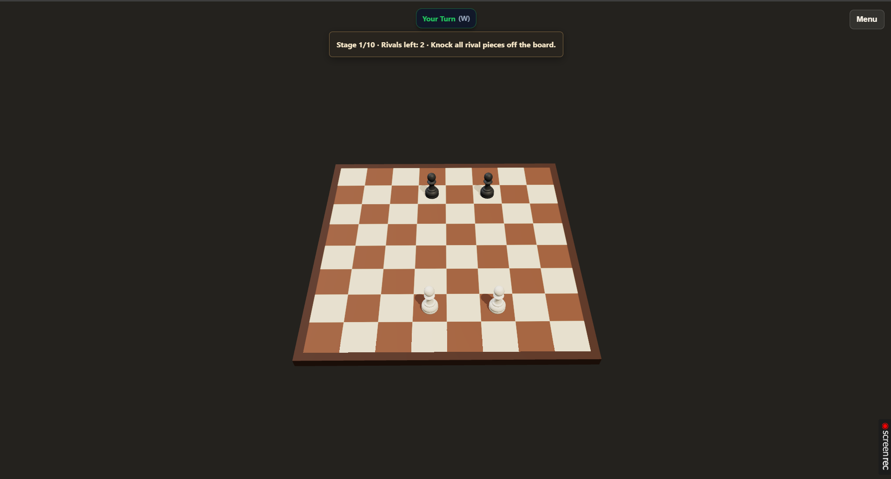

# 체스 알까기 마우스 정밀 조준 및 전체화면 줌 개선 기획서

2026-11-13 · v1.0 · 기획 초안 / 구현·플레이 검증 전

> 2026-11-13 후속: [1차 로컬 구현·검증 결과](../qa/darius-input-2026-11-13/RESULT-ko.md)를 추가했다. 최종 후보는 기하·브라우저 비교에 따라 지수 2.4와 화면별 당김 예산을 적용했다. 아래 원래 후보·목표·not-run 표는 기획 당시 기록으로 보존하며, 현재 실행 상태와 미검증 범위는 결과서의 요구사항별 표를 따른다. 사용자 체감·실기기 검증과 신규 공개 배포는 아직 수행하지 않았다.

**목표는 말을 충분히 크게 보면서, 작은 마우스 움직임으로 힘과 방향이 급변하지 않도록 조작 여유를 넓히는 것이다.** 말을 누르고 → 뒤로 당겨 힘·방향을 정하고 → 놓아 튕기는 알까기 조작을 유지한다.

이 문서는 Darius256의 추가 피드백을 근거로 한 후속 기획이다. 기존 [플레이테스트 개선 기획서 v1.1](체스%20알까기%20플레이테스트%20QA%20및%20개선%20기획서_2026-11-12.md)의 PF-R02·PF-R03을 구체화한다. 새 요구사항은 `DA-Rxx`, 검증은 `DA-Txx`로 구분한다. 이번 작업은 문서 작성이며 게임 수정이나 신규 배포를 의미하지 않는다.

## 1. 피드백과 증거

### 플레이어가 보고한 내용

| ID | 관찰 | 의미와 한계 |
|---|---|---|
| DA-F01 | 전체 화면에서 최대한 확대해도 보드가 화면의 30% 미만으로 느껴짐 | 확대 상한과 기본 구도를 점검한다. 30%가 너비·높이·면적 중 무엇인지는 확인되지 않았다. |
| DA-F02 | 거의 움직이지 않는 힘부터 매우 강한 힘까지 약 80px 이동에 몰려 있음 | 마우스 이동당 파워 변화가 큼. 80px는 제보자의 관찰이며 CSS px 실측값으로 확정하지 않는다. |
| DA-F03 | 약 30% 힘에서 방향을 45도 바꾸는 데 약 12px 이동이면 됨 | 약한 샷에서 방향을 조절할 공간이 부족함. 측정 경로·기준 좌표는 미확인이다. |
| DA-F04 | 왼쪽 파워 퍼센트 표시가 힘의 차이를 이해하는 데 도움이 됨 | 기존 숫자 표시를 유지한다. 표시 개선만으로 정밀 조작이 해결됐다고 보지 않는다. |

조건은 **노트북 / 웹 버전 / 마우스 / 전체 화면**이다. 정확한 브라우저, OS 배율, 브라우저 배율, DPR, iframe·캔버스 크기, 선택한 거리 설정과 빌드 ID는 제공되지 않았다. 이전 배포 직후의 대화이지만 제보자가 실행한 빌드를 1.0.20으로 단정하지 않는다. 같은 참여자의 후속 의견이므로 독립 참여자가 늘어난 것으로 집계하지 않는다.

출처는 사용자가 이번 대화에 전달한 [추가 댓글 원문 스냅샷](assets/darius-input-prd-2026-11-13/feedback-source.md)과 첨부 이미지다. 새 댓글의 개별 URL·작성 시각은 미제공이며 임의로 보충하지 않았다.

### REF-01: 실제 제보 화면

- 원본: 대화에 첨부된 PNG, 1917×1032. 보드·기물, 상단 턴·목표, 우측 메뉴가 보인다. 화면 오른쪽의 녹화 표시는 게임 UI 사양에 포함하지 않는다.
- 보드가 화면 중앙 하단에 작게 배치되고 위·좌우에 넓은 빈 공간이 있는 모습은 확인된다. 최대 줌 도달 여부·포인터 이동·파워 변화는 정지 이미지로 확인할 수 없다.
- 이 이미지는 **문제 상태의 참고 자료**다. 이 크기를 재현해야 하는 목표 시안이 아니다. 향후 수정 화면은 동일한 viewport·카메라 방향·배치에서 비교한다.

## 2. 현재 구현에서 확인한 구조

조사 기준은 로컬 develop `c2649005f455600e44ffedb583e2cd12b4e4b888`의 관련 소스다. 이전 main 배포는 `89b9c0868144c016f41c7c392bb35b605513be1f`이며 두 커밋의 해당 실행 코드는 같다. 실제 재현 때는 실행 빌드·작업 폴더 변경을 다시 기록한다.

| 항목 | 소스 확인 | 이번 문제와의 관계 |
|---|---|---|
| 거리 설정 | [power-controls.ts](../web/src/power-controls.ts)의 180/240/360px, 기본 180px | 선택값과 실제값이 다를 수 있다. 설정을 360으로 바꾼 것만으로 개선을 주장할 수 없다. |
| 화면 기반 상한 | 같은 파일의 `reserve = 0.18 × min(W,H)`, `D = min(설정값, reserve × 0.8 / 1.5)` | 실제 100% 거리가 짧은 변의 9.6% 이하로 줄어든다. 일반적인 화면에서는 세 설정이 같은 값으로 제한될 수 있다. |
| 클래식 파워 | [aim.ts](../web/src/aim.ts)의 `p = min(드래그 길이 / D, 기물별 상한)` | 짧은 D에서 픽셀당 힘 변화가 커진다. 방향도 같은 드래그 벡터에서 계산한다. |
| 당구식 파워 | [input.ts](../web/src/input.ts)의 `computeRedDotPullPower` | 빨간 점 아래로 당긴 세로 거리로 파워를 계산한다. 클래식의 2차원 방향 문제와 분리한다. |
| 카메라 | [scene.ts](../web/src/scene.ts)의 `computeMinimumCameraDistance`, `fitCameraToBoard` | 보드가 상하좌우 여백 안에 들어가도록 최소 카메라 거리, 즉 최대 확대 한계를 설정한다. |
| 입력 안전성 | [input.ts](../web/src/input.ts)의 드래그 문턱·취소·리사이즈 처리 | 마우스 미세 이동, 화면 밖 release, 조작 중 환경 변경을 처리하는 기존 동작은 보존한다. |

**계산 예시일 뿐 재현 결과는 아니다:** 캔버스가 1366×768 CSS px이면 D의 상한은 73.728px, 1920×1080이면 103.68px다. 실제 캔버스는 HUD·iframe 때문에 화면보다 작을 수 있다. 제보의 약 80px와 양립 가능한 구조지만, 이것만으로 해당 환경에서 원인을 재현했다고 판단하지 않는다.

현재 계산은 150% 샷의 당길 공간을 확보하는 데 유리하지만, 정밀도와 보드 크기까지 만족시키는지는 별도 문제다. **도달 가능 여부·입력 정밀도·기물 식별 크기를 함께 통과해야 한다.**

## 3. 설계 원칙과 범위

### 유지할 행동

1. 당겨서 놓는 한 번의 제스처. 별도 파워 슬라이더, 발사 버튼, 길게 누르는 자동 충전, 화면 가장자리 전용 조작은 추가하지 않는다.
2. 같은 화면·마우스 설정에서는 같은 거리·방향의 입력이 같은 입력 파워·방향을 만든다. 선택 말·위치·당김 방향에 따라 감도를 몰래 바꾸지 않는다.
3. 드래그 중 카메라와 입력 변환은 고정한다. 말 선택마다 자동 줌·자동 이동하지 않는다.
4. 파워 퍼센트·눈금·방향 안내를 유지하고, 표시와 최종 발사 요청은 같은 상태에서 계산한다.
5. 현재 기물의 100%/150% 조건, 나이트 보정, 타점·스핀, 물리 속도·질량·마찰은 유지한다. 입력 문제와 물리 밸런스를 동시에 바꾸지 않는다.

### 이번 우선 범위

- P0: 현재 공개 웹의 실제 D·최대 줌 재현과 계측.
- P1: 마우스 파워·방향 정밀도와 전체 화면 보드 크기를 함께 개선하는 비교 후보.
- P1: 경계·취소·최종 release·기물 상한 회귀.
- P2: 설정 설명과 튜토리얼 제스처의 실제 거리 일치.

마우스를 우선 조정한다. 터치 감도는 별도 과제로 두고 공통 코드 변경의 회귀만 확인한다. 신규 기물 능력, 토너먼트, 꾸미기, 난이도·업그레이드 수치 변경은 이번 범위에 넣지 않는다.

## 4. 개선 요구사항

### DA-R01: 희망 거리보다 실제 조작 여유를 확보한다

**결과:** 180/240/360px 설정이 화면 상한 때문에 모두 80px 안팎으로 동작하는 상황을 확인하고, 비교 화면에서 실제 차이를 제공한다.

- 18% 여백·80% 계수·150% 상한으로 D를 일괄 축소하는 현재 정책을 재검토한다. 상한 삭제만으로 끝내지 않고 카메라 구도와 가능한 release 영역을 함께 계산한다.
- 초기 비교는 100% 기준 **실제 D=180px**를 우선 후보로 삼고, 공간이 허용되는 환경에서 240px도 비교한다. 기본값 변경은 결과를 본 뒤 결정한다.
- 180px 확보는 마우스용 비교 목표이며 모든 크기에서 보장된 구현 수치가 아니다. 작은 iframe에서 확보하지 못하면 실제값·최대 도달 파워·공간 제약을 기록한다. 설정명만 정밀로 바꾸거나 실제값이 같은 프리셋을 서로 다른 후보로 비교하지 않는다.
- 픽셀은 `clientX/Y`와 캔버스 rect 기준의 **CSS px**다. 물리 화면 픽셀·DPR·브라우저 배율과 구분한다.

### DA-R02: 약한 샷에서도 방향을 고칠 거리를 넓힌다

**결과:** 20~40% 샷에서 커서를 조금 움직였을 때 방향이 급격히 바뀌는 부담을 줄인다. 파워와 방향은 같은 당김에서 계속 조절한다.

먼저 D 자체를 늘린 선형 후보를 비교한다. 그 결과가 부족할 때만 낮은 파워 구간에 더 긴 거리를 배정하는 곡선을 비교한다. 각 후보는 별도 빌드 또는 명시적인 로컬 QA 설정으로 고정하며 실제 플레이 도중 자동 전환하지 않는다.

| 비교 후보 | 변환 | 30%일 때 반경 | 100% / 150% 필요 거리 | 목적 |
|---|---|---:|---:|---|
| A 현재 기준 | 실제 D를 계측, 선형 `p=d/D` | `0.3D` | `D` / `1.5D` | 같은 실행 환경의 기준값 확보 |
| B 우선 후보 | 실제 D=180px, 선형 | 54px | 180 / 270px | 기존 감각을 유지하며 거리 제한 영향을 분리 |
| C 확장 후보 | 실제 D=240px, 선형 | 72px | 240 / 360px | 더 긴 마우스 움직임의 이득·피로 비교 |
| D 보조 실험 | D=180px, `p=(d/D)²` | 약 98.6px | 180 / 약 220.5px | 낮은 파워에서 방향·세기 조절 공간 확대 |

수치는 **후보의 수학적 특성**이며 실제 공간 확보·사용성 통과 결과가 아니다. D 후보의 100% 이상도 같은 곡선을 연장하고 해당 기물 상한에서 제한한다. 나이트의 실제 발사 보정과 입력 p를 혼동하지 않는다. 후보를 적용한다면 파워에서 거리로 되돌리는 안내·튜토리얼 계산도 같은 역함수를 써야 한다.

약한 파워에서의 방향 민감도는 드래그 반경과 함께 평가한다. 선형 D=80px의 30%는 반경 24px, D=180px에서는 54px다. 화면상 반경을 유지하며 45도 회전할 때의 두 끝점 직선 거리는 `2r × sin(22.5°)`이므로 각각 약 18.4px·41.3px다. 이는 제보의 12px를 검증하거나 반박하는 계산이 아니다. 실제 커서 경로·파워 유지 여부·3D 투영 조건이 알려지지 않았기 때문이다.

**초기 비교 목표:** 30% 입력의 반경 ≥50 CSS px, 그 상태에서 화면상 방향을 1도 바꾸는 접선 이동 ≥0.87px. 먼저 화면상 입력 각도를 검증하고 이후 월드 방향과의 관계를 별도 기록한다. 평균화·프레임 지연·각도 스냅으로 이 목표를 대신 통과시키지 않는다.

곡선 D는 전체 구간의 감각을 바꾸며, 높은 파워에서는 픽셀당 변화량이 더 커질 수 있다. 10/20/30%뿐 아니라 75/100%도 검사한다. B만으로 충분하면 C·D를 제품 옵션으로 추가하지 않는다.

### DA-R03: 전체 화면에서 보드를 더 크게 볼 수 있게 한다

**결과:** 마우스 휠로 확대했을 때 보드가 작은 상태에서 불필요하게 멈추지 않으며, 말과 보드 경계를 식별하기 쉽다.

- 초기 구도와 사용자가 도달할 수 있는 최대 확대를 각각 확인한다. `minDistance` 숫자 하나를 줄이는 수정으로 완료 처리하지 않는다.
- 초기 구도는 기존 보드 중심·기울기·턴 방향을 유지한다. 최대 확대에서도 보드·선택 가능한 말·필수 HUD가 잘리지 않아야 한다. 확대 기준은 보드 중심으로 유지하고 선택 말 추적 카메라는 추가하지 않는다.
- **초기 시각 비교 목표:** 16:9 데스크톱의 최대 확대에서 보드 투영 bounding box 높이가 유효 게임 캔버스 높이의 55~65%인 안을 우선 비교한다. 기본 구도는 사용자가 처음부터 조작하기 적절한 크기로 별도 결정한다.
- 55~65%는 제보의 ‘30%’를 같은 지표로 해석한 값이 아니라 새 제안 목표다. 투영 보드의 면적 비율·너비·높이를 함께 보고하고, 체스판 모서리·선택 기물·보조 타점까지 확인한다.
- 휠 확대/축소 후 모드 전환, 턴 변경, 메뉴 복귀, 전체 화면 진입·이탈에서 기존 카메라 정책과 충돌하는지 확인한다. 당구식의 의도적인 조준 카메라와 클래식 보드 줌을 별도 기록한다.

### DA-R04: 보드 크기와 당길 여유의 충돌을 숨기지 않는다

긴 당김 거리와 큰 보드, 네 가장자리에서의 모든 방향·전체 파워를 한 화면에 동시에 확보하기 어려울 수 있다. 정밀도를 위해 D를 늘린 뒤 보드를 더 작게 만드는 순환은 채택하지 않는다.

- 각 구도에서 실제 선택 가능한 시작점과 8방향의 연속 release 공간을 측정한다. 보드 바깥으로 나갈 수 있는 기물·기울어진 말·타점 범위도 포함한다. 단순 보드 꼭짓점 여백으로 대체하지 않는다.
- 선형은 `p_max × D`, 제곱 후보는 `D × sqrt(p_max)`만큼의 당김이 필요하다. 모든 지원 시작점·방향의 최소 공간 R_min이 이 거리 이상이어야 한다.
- 예를 들어 높이 720px에 선형 D=240px의 150%를 상하 360px씩 예약하면 보드를 둘 세로 공간이 남지 않는다. 이런 조합을 지원한다고 문서에 약속하지 않는다. 실제 기물 위치를 고려한 계산도 별도로 필요하다.
- 마우스 포인터 캡처는 iframe 밖의 유효 release 공간을 만들어주지 않는다. iframe 밖 release 허용, 강제 Pointer Lock, 자동 충전, 가장자리 전용 파워 단계로 우회하지 않는다.
- **채택 규칙:** 지원 화면별로 보드 가독성·부분 파워 정밀도·경계 최대 파워를 모두 확인한다. 동시 충족이 안 되는 조합은 미해결로 남긴다. 실패를 숨기기 위해 위치별 감도를 바꾸거나 선택 가능한 말을 막지 않는다.
- 초기 시각 목표와 입력 후보가 충돌하면 실제 제약·후보별 손익을 정리해 다음 설계를 결정한다. 이 문서만으로 ‘모든 화면에서 180px 및 보드 높이 55% 보장’을 확정하지 않는다. 기존 PF-R02 지원 범위·수용 기준을 축소하려면 그 변경을 별도 명시하고 사용자 결정을 받는다.

### DA-R05: 표시·입력의 신뢰성을 유지한다

- 왼쪽 퍼센트 표시와 기존 눈금은 유지한다. HUD 숫자를 크게 하거나 새 패널을 추가하는 것을 핵심 해결책으로 삼지 않는다.
- 반올림 전 파워를 발사 요청과 공유한다. release 직전에 커서를 움직였으면 마지막 move가 아니라 실제 release 좌표를 적용한다.
- 거리·곡선·canvas rect·카메라 축은 드래그 시작 때 고정한다. 전체 화면/창 크기/배율/설정이 바뀌면 진행 중 조작을 취소하고 새 기준을 적용한다. 자동 발사하지 않는다.
- 클릭·미세 손떨림은 턴을 소비하지 않는다. 문턱을 넘긴 뒤 말 쪽으로 돌아와 낮은 파워로 놓는 샷은 기존 규칙대로 허용한다.
- 취소 영역·ESC·우클릭·pointercancel·blur·중복 release 방어를 보존한다. 100%와 기물별 150%가 서로 다른 기준 거리로 표시되지 않게 한다.
- 설정에는 희망 거리·실제 100% 거리·제약 이유를 표시한다. 기존 설정 키를 재사용할 수 있는지 먼저 확인하고 저장값을 조용히 다른 의미로 해석하지 않는다.

## 5. 화면·행동 계약

새 메뉴·발사 단계 없이 현재 게임 화면 안에서 변경한다. 아래는 신규 제안이며 시안 구현 결과가 아니다.

| 상태 | 유지할 화면 요소 | 바뀌어야 하는 경험 | 확인 방법 |
|---|---|---|---|
| 판 시작 / 전체 화면 | 상단 턴·스테이지·우측 메뉴, 기존 보드 아트 | 보드·말을 더 크게 식별 | REF-01과 같은 방향·viewport의 수정 화면 병렬 비교 |
| 최대 확대 | 휠 줌과 현재 카메라 방향 | 충분한 확대와 보드·HUD 가시성 | 보드 투영 너비·높이·면적 및 겹침 기록 |
| 30% 조준 | 선택 표시·방향 안내·왼쪽 파워 표시·취소 | 더 긴 반경에서 방향 미세 조절 | start/cursor 좌표, p, 화면상 각도와 최종 방향 기록 |
| 가장자리 조준 | 같은 한 번의 당김·놓기 | 중앙과 동일한 변환 및 허용 최대 파워 도달 | 중앙/모서리×8방향, 상한별 실제 release |
| 설정 | 기존 조작 탭과 거리 프리셋 | 희망값·실제값 차이를 이해 | 실제값이 같은 프리셋을 구분해 안내 |
| 화면 변경 중 조준 | 기존 취소·재조준 경로 | 잘못된 샷·감도 급변 방지 | 전체 화면 진입/이탈·resize 직전후 취소 확인 |

## 6. QA 및 수용 기준

모든 항목은 현재 **not-run**이다. 숫자 목표는 초기 채택 기준이며 완료 실적이 아니다. 코드 검사·브라우저 자동 입력·실제 이용자 과제를 구분해 기록한다.

### 환경 기록

- 웹 마우스: 1366×768, 1920×1080 전체 화면 및 일반 창, 1280×720, 800×450 iframe. 화면 해상도와 실제 캔버스 CSS 크기를 따로 남긴다.
- 배율: 브라우저 100/125/150%, DPR 1/2 대표 조건. 자동화의 CSS 좌표 시험과 OS 마우스 감도 영향을 받는 실제 노트북 시험을 구분한다.
- 모드: 클래식 우선, 공통 경로와 당구식 빨간 점 회귀. 터치 390×844 및 Android·일반 웹·CrazyGames는 영향 경로만 별도 확인한다.
- 기록값: 빌드·브라우저·입력 장치·설정값·실제 D·곡선·구도·보드 크기·기물·자세·타점·허용 상한·포인터 좌표·표시 파워·요청 파워·월드 방향·취소 이유.

| QA ID | 연결 | 절차와 기대 결과 | 상태 |
|---|---|---|---|
| DA-T01 | R01 / F02 | 현행 빌드에서 3개 프리셋의 실제 100%·150% 거리를 계측하고 전체 화면 진입 전후 상한과 비교. 제보와 일치하지 않아도 측정 결과를 그대로 기록 | not-run |
| DA-T02 | R03 / F01 | 같은 판·각도에서 최소/최대 줌, board bbox/면적, 말·HUD 잘림을 캡처. 55~65% 시각 후보와 실제 조작 공간을 함께 평가 | not-run |
| DA-T03 | R01·02 | 같은 화면에서 A/B, 필요 시 C/D 비교. 30% 반경 ≥50px, 화면상 1도 접선 이동 ≥0.87px 목표. 곡선·D 하나씩 바꿔 효과 분리 | not-run |
| DA-T04 | R02·05 | 10/20/30/50/75/100%, 허용 시 150%에서 거리→HUD→release 값 확인. 요청 파워 절대 오차 ≤0.005, HUD 반올림 오차 ≤1%p | not-run |
| DA-T05 | R02 | 같은 사람이 20/30/50%를 각 5회 선택. 각 목표 ±5%p 안에 4/5회 이상을 초기 목표로 사용. 후보 순서를 교차하고 과대/과소 입력·피로도 기록 | not-run |
| DA-T06 | R02 | 30%±5%p를 유지하며 기준 방향에서 ±5도·±15도·45도 조절. 작은 각도 과제는 목표 ±2도 안에 4/5회 이상을 초기 목표로 사용. 큰 방향 전환의 실제 포인터 경로·힘 변화도 기록 | not-run |
| DA-T07 | R04 | 중앙·네 모서리 및 유효 경계 기물×8방향×100/150% 조건. R_min·필요 거리·유효 release를 기록. 도달 불가나 강제 취소가 있으면 해당 조합 실패 | not-run |
| DA-T08 | R04·05 | 동일 입력을 중앙·경계·다른 기물에서 비교. 100% 기준 변환 일치, 별도 상한은 규칙대로 제한. 선택마다 카메라 이동·감도 변경 0회 | not-run |
| DA-T09 | R05 | 클릭·미세 이동·문턱 통과 후 약한 샷·최종 move/up 불일치·중복 up·취소·화면 밖 release. 무효 샷 0회, 유효 샷 1회 | not-run |
| DA-T10 | R03·05 | 드래그 중 resize·배율·전체 화면 진입/이탈·설정 변경. 취소 후 재조준, 자동 발사 0회. 비조준 중 최대 확대 재계산·HUD 겹침 확인 | not-run |
| DA-T11 | R01·05 | 세 프리셋의 희망·실제값·저장/초기화·한/영 표시 확인. 같은 실제값이면 차이를 암시하지 않음. 튜토리얼 손짓·성공 범위도 실제 변환과 일치 | not-run |
| DA-T12 | 공통 회귀 | 당구식·터치·기물 특수조건·카메라 전환·취소·턴 종료 확인. 같은 입력 p의 실제 발사 물리 결과가 의도치 않게 바뀌지 않음 | not-run |

실제 사용자 과제에서는 ‘상대를 떨어뜨리고 내 말은 남기기’도 동일 배치로 관찰하되 성공률만으로 정밀도 개선을 판정하지 않는다. 입력 오차와 전술 판단·충돌 결과를 분리한다. 가능하면 Darius256에게 같은 조건의 재시험을 요청하되 응답 전에는 체감 문제가 해결됐다고 표현하지 않는다.

## 7. 실행 순서와 채택 결정

1. **기준 재현:** DA-T01·02로 실제 D, 제한 원인, 최대 줌, 캔버스 크기를 기록한다. 자동 입력만으로 사용자의 마우스 감각을 재현했다고 주장하지 않는다.
2. **최소 후보:** 현재 구도에서 실제 D를 늘릴 수 있는 R_min부터 측정한다. 실제 D=180px 선형 B를 우선 비교하고, 카메라 여백은 18%→16%를 첫 구도 후보로 별도 비교한다. 16%는 시험값이며 새 거리 상한 공식으로 그대로 재사용하지 않는다. 거리만 변경·구도만 변경한 결과를 먼저 남긴 뒤 결합 후보를 검증한다. 전체 파워 도달 때문에 보드가 다시 작아지면 그 결과를 실패로 남긴다.
3. **필요한 실험만 추가:** 공간이 충분한 화면은 240px 선형, 낮은 파워 각도 제어가 부족하면 제곱 곡선을 각각 비교한다. 모든 후보를 한꺼번에 설정에 추가하지 않는다.
4. **한 가지 안 선택:** 입력 정확도·보드 크기·경계 도달성·피로도·기존 조작 감각을 함께 보고 채택한다. 특정 후보가 이겼다는 증거가 없으면 현행 대조군과 비교 결과를 남기고 미결정으로 둔다.
5. **회귀 및 인계:** 채택안에 맞춰 설정·안내·튜토리얼을 갱신하고 DA-T04~12를 수행한다. 실제 화면 비교, 기능 검사, 사용자 수용 결과를 각각 기록한 뒤 배포 후보를 만든다.

완료 보고에는 선택한 D·곡선·기본/최대 구도, 화면별 통과·실패, 비교 캡처, 테스트 기록, 남은 제한을 포함한다. 문서 작성 완료·계산식 일치·빌드 성공을 플레이 경험 개선 완료와 동일하게 취급하지 않는다.
