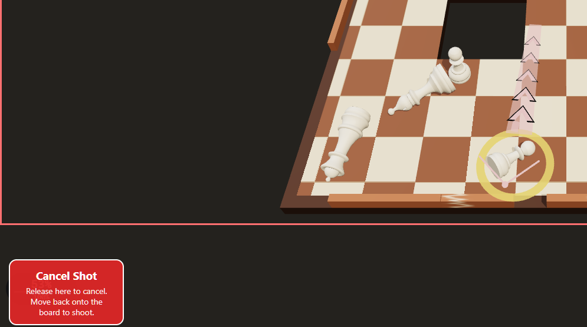
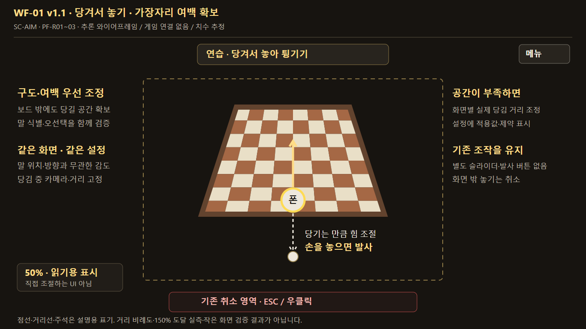
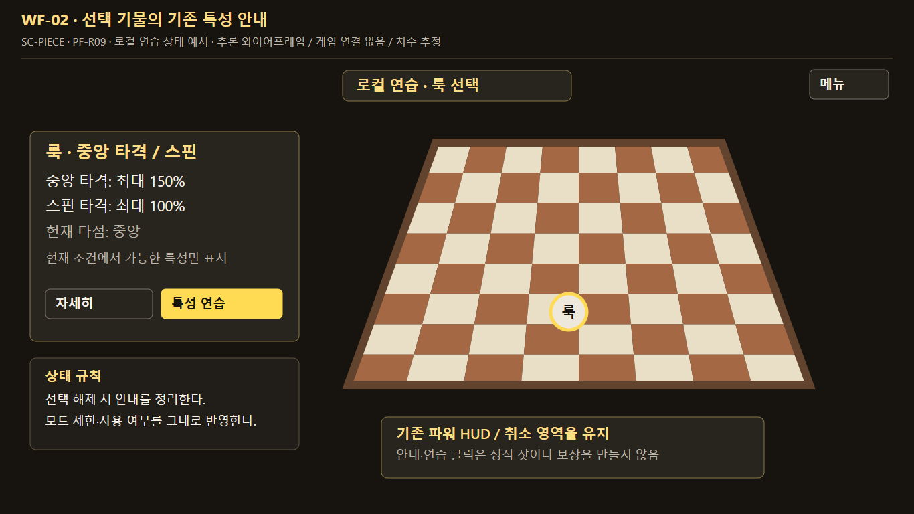
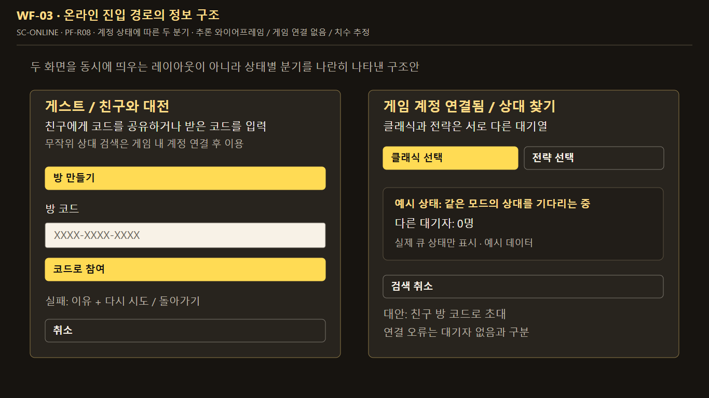

# 체스 알까기 플레이테스트 QA 및 개선 기획서

> 2026-11-13 후속 기획: Darius256의 추가 제보(전체 화면 보드 크기, 약 80px의 파워 범위, 저파워 방향 조절)는 [마우스 정밀 조준 및 전체화면 줌 개선 기획서](체스%20알까기%20마우스%20정밀%20조준%20및%20전체화면%20줌%20개선%20기획서_2026-11-13.md)에 정리했다. 아래 v1.1의 당시 상태·검증 이력은 보존한다.

2026-11-12 · v1.1 · 1차 로컬 구현·검증, 사용자 수용 판단 대기 · 대상: itch.io 웹 플레이테스트와 공통 입력의 영향 범위

**다음 개선의 목표는 ‘강하게 쏘기’보다 ‘원하는 힘으로 쏘고 내 말을 남기는 선택’을 가능하게 하는 것이다.** 먼저 무효 입력과 화면 가장자리 조준을 검증하고, 이미 구현한 부분 파워 조절·설명 개선을 실제 이용자가 이해하는지 확인한다. 그다음 기존 기물 특성을 드러내는 실험을 진행한다. 토너먼트와 개인 문장은 후속 확장으로 둔다.

**조작 원칙: 말을 당긴 거리로 힘을 정하고, 놓는 순간 튕긴다.** 가장자리 문제도 이 한 동작 안에서 해결한다. 사용자 검토를 반영해 v1.0의 별도 파워 슬라이더·발사 버튼 안은 제외했다. 보드 여백과 카메라 구도를 먼저 조정하고, 부족하면 화면 크기별 당김 거리를 조정한다.

이 문서는 개발·QA의 기준이다. 후속 구현 요청으로 입력·구도·설정·기물 안내를 로컬에 적용하고 검증했으며, 실행 근거와 남은 수용 판단은 [1차 구현 및 검증 결과](../qa/playtest-prd-2026-11-12/RESULT-ko.md)에 기록했다. 모든 제안·실험이 채택되거나 공개 배포된 것은 아니다. 화면 예시는 아래에서 **실제 제보 / 과거 로컬 캡처 / 신규 제안 와이어프레임**으로 구분한다.

- [화면 자료와 제안 와이어프레임 모음](assets/playtest-prd-2026-11-12/screen-spec.html)
- [실행용 QA 체크리스트](체스%20알까기%20플레이테스트%20QA%20체크리스트_2026-11-12.md)
- [댓글 정리 원본 스냅샷](assets/playtest-prd-2026-11-12/Playtest_Feedback_2026-11-12.source.md)
- [기존 11월 11일 기획](체스%20알까기%20itch%20플레이어%20피드백%20개선%20기획서_2026-11-11.md), [해당 구현·QA 결과](../qa/itch-feedback-2026-11-11/RESULT-ko.md)

## 1. 판단 근거와 현재 상태

### 피드백의 범위

외부 플레이어 **3명, 피드백 댓글 6개**를 근거로 한다. 동일인의 후속 댓글과 개발자 답변을 독립 표본으로 세지 않는다. 상세 입력 문제는 주로 Darius256의 노트북·웹·마우스 경험이며, 전체 이용자의 결함 발생률이나 이탈률로 확대하지 않는다.

| 출처 | 관찰 | 기획에 반영할 의미 |
|---|---|---|
| S01·S02 Darius256 | 부분 파워 조절의 어려움, 클릭 시 턴 소모, 하단 말 조준 제약, 강화 체감·매칭 발견성 | 입력의 유효성·도달성·가독성을 먼저 검증한다. 정밀 조작 때문에 중단했다는 설명을 우선순위 근거로 삼는다. |
| S03 Nadatarama Games | 빠른 라운드와 3대3→벽→중앙 구멍 진행은 좋음. 벽·누운 기물 반응과 중량 이점은 불명확 | 진행과 재도전 속도를 보존하며 실제 물리 오류와 설명·기대 차이를 분리한다. |
| S04 matteotrincanato | 나이트 외 기물 차이가 약함. 방향 제한 또는 고유 능력, 온라인 확장 제안 | 기존 능력의 발견·사용을 먼저 확인하고 규칙 변경은 별도 실험한다. |

원문 링크와 플레이 조건은 [원본 스냅샷 2~5절](assets/playtest-prd-2026-11-12/Playtest_Feedback_2026-11-12.source.md)을 따른다. 댓글 당시 정확한 빌드·브라우저·해상도는 알려져 있지 않다.

### 기존 개선을 중복 개발하지 않는다

조사한 로컬 브랜치는 `develop`, HEAD는 `c82d1cd7e0c116598af7c134edaaa16f803b93d8`이다. 작업 폴더에는 기존 미커밋 변경이 있다. HEAD만으로 작업 폴더 전체나 공개 배포 버전을 대표하지 않는다.

| 구분 | 확인한 근거 | 이번 기획에서의 처리 |
|---|---|---|
| 11/11 입력·UI 개선 | 로컬에 180/240/360px 설정, 최종 release 재계산, 파워 눈금·경계 경고, 약한 샷 연습, 강화 설명·온라인 안내가 있음 | 기존 동작을 기준으로 재검증한다. 신규 기능처럼 다시 요구하지 않는다. |
| 과거 로컬 QA | 11/11 보고서는 브라우저 19개 기록, 실제 Rapier 측정, 카드·입력 검사를 보고함 | 해당 빌드의 이력으로 보존한다. 새 제보의 재현·개선 통과로 옮겨 쓰지 않는다. |
| 과거 빌드 | itch 후보 `285682579741-dirty-20261111055343` | 현재 작업 폴더와의 차이를 확인한 뒤 비교용으로 사용한다. |
| 공개 온라인 | 11/10 [보고서](../qa/itch-matchmaking-2026-11-10/RESULT-ko.md)는 대기열 등록·취소, 두 게스트의 친선전 샷 송수신을 보고함 | 매칭 발견성을 네트워크 장애로 단정하지 않는다. 서로 다른 로그인 계정의 경기 완료·정산은 별도 검증이다. |
| 공개 업데이트 여부 | 11/11 결과서는 해당 후보를 공개 itch에 업로드하지 않았다고 명시함 | 현재 라이브 빌드와 일치한다고 가정하지 않는다. 재검수 전에 실행 빌드부터 기록한다. |

**ID 주의:** 이 문서의 F01~F10은 **11/12 댓글 정리 문서의 ID**다. 11/11 기획서의 같은 F번호는 다른 의미를 가진다. 아래 새 요구사항은 `PF-Rxx`, 체크리스트는 `PF-Txx`로 연결한다.

## 2. 개선 범위와 우선순위

P0는 다음 변경 전에 확인할 핵심 조작 위험, P1은 후속 사용성·경험 개선, P2는 분리 실험, P3는 장기 후보를 뜻한다. 우선순위가 높다는 사실만으로 결함이 확정되는 것은 아니다.

| 피드백 | 요구 ID | 문제·기회 | 우선순위 | 처리 방향 | 연결 QA |
|---|---|---|---|---|---|
| F01 | PF-R01 | 클릭·작은 손 떨림에 턴이 소모됐다는 제보 | P0 | 발사 의도와 선택을 분리하고 승인된 샷만 소비 | T01~T03 |
| F02 | PF-R02 | 하단 말의 방향에 따라 최대 파워 도달이 어려움 | P0 | 당겨서 놓기를 유지하며 보드 여백·카메라 구도 우선, 화면별 고정 당김 거리 비교 | T04~T06 |
| F03 | PF-R03 | 약·중 파워 반복 선택이 어려움 | P0 | 기존 설정·눈금·연습을 기준으로 입력 정확도와 체감 비교 | T07~T08 |
| F04 | PF-R04 | 강화 전후 차이가 잘 느껴지지 않음 | P1 | 실제 수치 확인과 동일 조건 전후 체험 | T09 |
| F05 | PF-R05 | 중량 증가의 이점이 불명확 | P1 | 질량·초기 속도·최종 이동거리 설명 구분 | T10 |
| F06 | PF-R06 | 벽·누운 기물 반응이 어색함 | P1 재현 / P2 조정 | 자세·접촉·벽 상태별 비교 후 원인별 최소 수정 | T11~T12 |
| F07 | PF-R07 | Show more에 정보 이득이 적음 | P1 | 이미 제거한 일반 카드 중복 펼침 회귀 확인 | T13 |
| F08 | PF-R08 | 매칭 시작 방법을 알아채기 어려움 | P1 | 기존 안내의 발견성·대기 상태·복구 동작 확인 | T14~T15 |
| F09 | PF-R09 | 나이트 외 기물 차이가 약함 | P2 | 기존 특성 안내와 사용 과제부터 비교 | T16~T17 |
| F10 | PF-R10 | 1·5단계에 패배 집중 | P1 관찰 / P2 조정 | 조작 개선 뒤 실패 원인을 나눠 단일 요인 실험 | T18 |
| 유지할 강점 | PF-R11 | 짧은 라운드, 충돌음·음악, 진행 호기심 | 보존 | 공통 입력·저장·음향·재도전 회귀 | T19~T20 |

표의 Txx는 모두 `PF-Txx`의 약기다. 외부 댓글에서 나온 경로 예측·80% 이후 유지 충전·최대 힘 일괄 감소·추가 타격 효과는 채택이 확정되지 않은 비교 후보로 보존한다.

## 3. 조작 개선 사양

### PF-R01 선택·취소와 발사를 구분한다

**사용자 결과:** 말을 선택하거나 조준을 취소한 행위로 샷이 실행되지 않는다. 의도적인 아주 약한 샷은 가능해야 한다.

현재 `input.ts`는 0보다 큰 파워를 발사 후보로 만들고 큐 승인 결과에 따라 처리한다. `turn.ts`는 요청 범위를 검사한다. 따라서 제보를 ‘클릭은 무조건 발사됨’으로 단정하지 않고, 미세 이동·최종 좌표·실제 큐 승인·턴 변경을 함께 관찰한다.

1. **선택 → 조준 준비 → 유효 발사 요청 → 승인 → 물리 적용**을 구분한다. 같은 입력에서 승인·발사·턴 소비는 각각 최대 한 번이다.
2. 클릭, 0파워 release, 취소, 잘못된 말·턴, 창 이탈·포커스 상실, 중복 release에서는 발사하지 않는다. 턴 타이머는 기존 규칙대로 흐르며, 선택·취소로 새 턴을 받거나 시간을 초기화하지 않는다.
3. 손 떨림이 원인으로 재현되면 **마우스 4 CSS px / 터치 8 CSS px의 최대 변위 기준**을 첫 실험값으로 삼는다. 확정값이 아니며, touch는 별도 회귀 대상이다. 누적 이동거리가 아니라 누른 지점에서의 최대 변위로 판단한다.
4. 기준을 한 번 넘은 후 되돌려 아주 작은 양의 힘을 만드는 조작은 허용하는 안을 비교한다. 문턱 아래 힘을 강제로 큰 힘으로 올리거나 최저 발사 세기를 새로 추가하지 않는다.
5. 킹 교환·방어 등 별도 능력 버튼과 말 선택은 발사 제스처 문턱에 묶지 않는다. 기존 모드별 활성 조건을 따른다.

**수용 기준:** 0변위와 문턱 미만 미세 이동에서 샷·턴 전환 0회, 유효한 약한 샷과 정상 release에서 1회. 원인이 다른 경로라면 그 경로를 고치며 문턱을 불필요하게 추가하지 않는다.

### PF-R02 가장자리에서도 당겨서 놓는 감각을 유지한다

**사용자 결과:** 중앙과 가장자리 모두 같은 당김 감각으로 방향과 힘을 정하고, 손을 놓아 발사한다. 말의 위치·종류·방향 때문에 파워 감도가 바뀌지 않는다. 별도 파워 설정 단계나 발사 확정 버튼은 추가하지 않는다.

제보 REF-01은 하단 말과 `Cancel Shot` 영역이 함께 보이는 **995×555 raster**다. 전체 브라우저/iframe 캡처인지 잘린 이미지인지는 알 수 없다. 취소 영역이 원인이라는 가설은 동작 재현 전 확정하지 않는다.

#### 1순위: 보드 구도와 당길 여백

1. 중앙·네 모서리, 화면상 8방향, 기존 180/240/360px, 클래식/당구식에서 현재 도달 가능한 파워와 취소 경계를 기록한다. 룩·퀸의 조건부 150%도 포함한다.
2. 보드를 게임 캔버스 경계에 붙이지 않도록 전체 보드 구도와 여백을 조정한다. 클래식은 보드 테두리 밖이더라도 유효 캔버스 안에 당길 공간을 남긴다. 보드 사각형만이 아니라 실제 선택 가능한 기물·누운 자세·타점의 투영 범위 전체에서 최소 여백을 확인한다. 당구식은 기존 빨간 타점 아래의 당김 공간을 별도로 확인한다. 두 방식의 방향·타점 해석은 보존하며, 정상적으로 선택 가능한 말을 비활성화해 도달성 검사를 통과시키지 않는다.
3. 구도는 판 준비·설정 적용 단계에서 정하고 조작 전에 안정시킨다. 말 선택마다 자동 확대·이동하거나 가장자리 말만 따라 카메라를 옮기지 않는다. 당구식의 의도적인 조준 카메라 조작과 자동 구도 보정을 구분하고, 파워 드래그 중에는 카메라를 고정한다.
4. 보드·말·타점이 작아져 선택하기 어려워지는 구도는 채택하지 않는다. 기물 식별·오선택·조준 정확도와 당길 공간을 함께 비교한다. 실제 장외 말이 있는 화면 전체를 무조건 맞추는 자동 줌은 도입하지 않는다.

#### 2순위: 화면별로 고정한 당김 거리

여백만으로 부족하면 **viewport·입력 방식·선택 프리셋에 따른 하나의 실제 당김 거리**를 조작 시작 전에 정한다. 같은 조건에서는 선택 말·위치·방향·타점·강화·단계와 무관하게 같은 거리를 사용한다. 가장자리에서 당기는 방향에 따라 분모를 줄이는 적응형 감도는 사용하지 않는다.

- `D_preferred`: 설정에서 선택한 100% 기준 희망 당김 거리. 기존 마우스 180/240/360 CSS px는 선택 선호와 비교 기준으로 유지한다.
- `D_effective`: 해당 화면에서 실제로 사용하는 100% 기준 거리. 공간이 부족할 때만 희망값보다 짧게 조정하는 후보이며, 최대 물리 위력을 낮추는 값이 아니다. 100%까지 `D_effective`, 허용 시 150%까지 `1.5 × D_effective`를 당긴다.
- `R_min`: 고정한 구도에서 지원하는 모든 시작 위치·당김 방향의 **취소 영역·HUD를 제외한 연속 유효 release 공간 중 최소 길이**. 마우스는 게임 iframe 안에서 측정하며 CSS px와 DPR을 구분한다. 당구식은 지원하는 카메라 각도·높이·타점 범위까지 포함해 별도로 측정한다.
- 채택 조건은 전체 허용 파워에 필요한 거리가 `R_min` 안에 들어오는 것이다. 보수적 검사식은 `1.5 × D_effective ≤ R_min`이다. 구체 거리와 최소 조절 여유는 PF-R03의 반복 파워 과제 결과로 정한다. 드래그 시작 때의 말·방향만 보고 거리를 다시 계산하지 않는다.
- 지원 카메라 시점·거리·각도의 범위를 실제 사양에 남긴다. 유효한 시작점이 캔버스나 취소 경계에 붙어 `R_min=0`이 되면 양의 고정 거리로는 해결할 수 없다. 그 조건은 미해결로 기록하고 구도·시점 범위를 재검토한다. 시점 제한이 필요하면 기존 조준 선택을 얼마나 줄이는지도 비교하며, 말 위치별 자동 줌이나 비공개 감도 보정으로 우회하지 않는다.
- 800×450 화면에서는 360px의 150%인 540px 당김을 그대로 지원할 수 없다. 따라서 긴 프리셋을 모든 화면에서 그대로 보장하지 않는다. 실제 적용 거리가 짧아지면 설정에 희망값·실제값·화면 제약을 표시한다. 여러 프리셋의 실제값이 같아지면 그 차이가 없음을 알려 정밀도가 늘어나는 것처럼 보이지 않게 한다.
- 터치는 기존 80~180px 정책을 기준으로 별도 비교한다. 마우스의 공간 문제를 이유로 터치 감도를 일괄 변경하지 않는다. 입력 장치별 값이 달라도 같은 장치·화면·설정에서는 기물 위치와 무관하게 일관돼야 한다.

#### 입력 상태와 취소

선택 → 당김 → 유효한 위치에서 놓기 → 요청 승인 → 발사 흐름을 유지한다. 숫자·눈금·길이 표시는 읽기용이며 직접 파워를 설정하는 슬라이더가 아니다. 0파워, 미세 이동 무효 입력, 취소, 화면 밖 release, 중복 release는 PF-R01을 따른다. 기존 ESC·우클릭·취소 영역도 유지한다.

파워 드래그 중 카메라 구도·당김 거리·파워 곡선을 바꾸지 않는다. 리사이즈·배율·설정·입력 방식 변경으로 재계산이 필요하면 현재 조작을 먼저 취소하고, 새 기준이 준비된 뒤 다시 조준하게 한다. 타점 변경으로 실제 허용 상한이 낮아지는 경우에는 상한과 이유를 표시하되 100% 기준 거리는 바꾸지 않는다. 요청 거절은 이유와 재조준 경로를 제공하고 자동 재발사하지 않는다.

**수용 기준:** 선언한 지원 화면에서 같은 방향을 유지한 한 번의 당김·놓기로 전체 허용 파워에 도달하며, 동일한 당김 거리는 중앙·가장자리에서 같은 입력 파워가 된다. 보드 식별과 부분 파워 정밀도도 함께 충족해야 한다. 취소 영역 제거, 화면 밖 release 허용, 게이지·발사 버튼 추가로 통과시키지 않는다. 800×450 iframe 등 지정 검증 화면에서 실패하면 미해결로 남기고 구도·거리·최소 지원 조건을 재검토한다. 전체 화면·가로 보기 안내가 검증된 지원 범위의 실패를 대신 해결한 것으로 계산되지 않는다.

WF-01은 1366×768 설명용 구조안이다. 점선 여백·거리선·주석은 기획 설명 표시이며 게임에 그대로 추가할 UI가 아니다. 실제 거리·150% 도달·작은 화면 적합성을 실측한 결과가 아니며, 실제 기물·보드 아트는 단순 도형으로 나타냈다.

### PF-R03 파워를 읽고 반복 선택한다

기존 180/240/360px 설정과 25/50/75/100/150% 표시를 우선 사용한다. 희망 기본값 180px는 비교 결과가 나오기 전 유지하고, 화면 제약으로 달라지는 실제 거리는 PF-R02에 따라 별도로 표시한다. 색 외에 **현재 숫자·채워진 길이·눈금**을 함께 읽게 하며 방향 안내와 파워 표시를 구분한다. 표시를 직접 조작하는 별도 파워 단계는 만들지 않는다. 다른 게임 REF-02는 길이 표현의 참고이며 색·그래픽·효과의 복제 목표가 아니다.

- HUD와 발사 요청은 같은 반올림 전 파워 상태를 사용한다. 최종 release 좌표가 마지막 move와 달라도 일치해야 한다.
- 제안 수용값: 내부 정규화 파워 오차 ≤0.005, HUD 반올림 차이 ≤1%p. 이는 입력 파워 기준이며, 나이트의 최소 발사 보정이나 기물별 실제 속도를 동일하게 만들라는 뜻이 아니다.
- 같은 빈 보드에서 25/50/75%를 각각 5번 선택한다. **각 목표 ±5%p 안에 4/5회 이상**을 초기 사용성 목표로 둔다. 기존값과 후보를 같은 사람·조건에서 비교하고 순서를 바꿔 학습 효과를 줄인다. 희망값과 실제 적용값을 모두 기록하고, 서로 같은 실제값인 프리셋을 다른 감도 조건으로 중복 비교하지 않는다. 소수 이용자 통과로 전체 효과를 통계적으로 주장하지 않는다.
- 이미 있는 30~50% 연습은 선택형으로 유지한다. 성공 조건은 파워 선택이며 상대 장외·내 말 생존을 요구하지 않는다. 실전 전술 과제는 별도로 표시한다.
- 정밀 조준은 의도 실행을 돕는다. 자동 명중·자동 생존·정확한 충돌 후 궤적은 약속하지 않는다.

## 4. 강화·물리·진행 사양

### PF-R04·05·07 강화 정보와 실제 효과를 연결한다

기존 개선 화면의 **효과명 → 실제 전후값 → 사용 상황 → 교환 조건·상한 → 적용 시점** 순서를 보존한다. 일반 카드의 중복 펼침을 되살리지 않는다. 특수 카드만 실제 추가 규칙을 펼친다.

- 전후값은 기물 기본값·연구·선택 등급·상한을 반영한다. 5%→8% 교체를 추가 8% 또는 합계 13%라고 쓰지 않는다.
- 중량은 **질량 증가**, 힘은 **같은 파워의 초기 발사 속도 변화**로 구분한다. 현재 발사 모델은 질량을 곱한 충격량을 쓰므로 중량만으로 초기 속도가 낮아진다고 설명하지 않는다. 최종 거리·장외 저항의 고정 증가율도 실측 없이 보장하지 않는다.
- 비교 체험이 필요하면 같은 배치·자세·타점·파워에서 강화 전후를 교대로 실행한다. 실제 차이가 없는 상한 상태는 선택 전 알린다.
- 카드 선택 실패·재시도·중복 클릭은 한 번 적용 원칙을 유지한다. 설명 펼침·키보드 탐색이 선택을 실행하지 않아야 한다.

**수용 기준:** 표시값과 실제 적용값의 대응, 일반·상한·특수 카드 확인, 이용자가 중량과 힘의 차이를 설명할 수 있는지 기록한다. 체감이 약하다는 의견만으로 모든 강화 수치를 올리지 않는다.

### PF-R06 벽·자세의 기대와 실제를 맞춘다

기존 로컬 측정에서는 자세별 회전·이동 차이와 벽 규칙이 관찰됐다. 이는 제보자의 어색함이 해소됐다는 증거가 아니다. 아래 조건으로 재현하고 화면·접촉·수치를 함께 비교한다.

| 대상 | 비교 조건 | 기록할 결과 | 변경 판단 |
|---|---|---|---|
| 벽 | 파괴/불파괴, 정면/비스듬함/모서리/seam, 저속/고속, 낮은 벽 위 통과 | 메시·충돌체, 접촉 횟수, 파괴 시점, 반발·관통, 예상과 다른 반응 | 불일치가 있으면 해당 형상·시점부터 수정. 공통 반발·마찰은 단독 실험 |
| 기물 자세 | 선 자세/기울임/누움 × 중심/표면 타점 × 25/50/100% | 초기 선속도·각속도, 이동·회전, 정착 시간, 강제 보정 여부 | 오류와 설계 선택을 구분. 임의 누움 패널티 선도입 금지 |

이동·정착 시간에는 실제 시간과 시뮬레이션 시간을 구분한다. 물리 변경 시 온라인 양쪽 클라이언트·리플레이·턴 종료 조건의 영향을 확인하며, 우선 solo 비교 빌드로 한정한다. 차이가 의도된 규칙이면 기존 3·7단계 안내를 검증하고 화면과 맞는 설명을 쓴다.

### PF-R10 조작 문제를 줄인 뒤 난도를 조정한다

정식 1단계 3대3과 첫 샷 연습을 구분한다. 1·5단계에서 과대/과소 파워, 자기 말 장외, 적 선제 행동, 거대 폰, 무승부를 나눠 기록한다. 동일한 카드·배치의 4→5→6단계를 비교한다.

조작 개선 뒤에도 5단계 병목이 남으면, 기존 기획의 **거대 폰 도입을 6단계로 미루는 안 하나**를 비교한다. 적 힘·중량·크기를 동시에 줄이지 않는다. 병목이 6단계로 옮겨가거나 전략 선택이 줄면 채택하지 않는다. 기존 무승부 재경기의 동일 단계·강화·체크포인트 보존을 회귀 검사한다.

## 5. 기물별 차별화 기획

### PF-R09 먼저 기존 능력을 알아보고 쓰게 한다

현재 코드에는 이미 기물 차이가 있다. 아래는 **소스에서 확인한 기능**이며 모든 모드의 실제 사용 가능·플레이 체감이 검증됐다는 뜻이 아니다. 안내는 현재 모드에서 실행 가능한 기능만 표시한다.

| 기물 | 현재 확인한 특성 | 이해·사용을 확인할 과제 |
|---|---|---|
| 나이트 | 고정 앙각 도약, 입력 파워의 최소 보정 | 앞의 장애물을 넘기는 선택을 설명할 수 있는가 |
| 룩 | 중앙/무회전 타점의 최대 150%, 스핀 시 100% | 타점 변경으로 파워 상한이 바뀌는 이유를 아는가 |
| 비숍 | 편심 스핀 증폭과 충돌 시 굴절 | 중앙과 편심 타격을 다르게 선택하는가 |
| 퀸 | 오버드라이브와 스핀 특성 | 룩·비숍과의 공통점·차이와 실제 제한을 아는가 |
| 폰 | 상대 끝 진영 생존 시 승격 경로 | 해당 모드에서 승격 가능 여부를 알아보는가 |
| 킹 | 교환/방어 중 하나를 쓰는 특수 행동 | 잔여 사용·모드 제한을 아는가 |

온라인에서 킹 특수 행동·승격은 동기화 제약으로 제한돼 있으며, 킹 행동은 퍼즐에서도 차단된다. 안내 추가를 이유로 이 제한을 해제하지 않는다. 기능 존재 여부는 [config.ts](../web/src/config.ts), [aim.ts](../web/src/aim.ts), [input.ts](../web/src/input.ts), [turn.ts](../web/src/turn.ts)를 기준으로 다시 확인한다.

기존 도움말의 능력 문구와 전략 준비 화면의 기물 선택 UI는 재사용 후보이다. 일반 대국에서 선택 말 이름·능력을 항상 보여주는 HUD는 이번 정적 검토에서 확인하지 못했다. 따라서 단순히 ‘설명이 전혀 없다’고 결론짓지 않고, 도움말에서 실제 조준으로 정보가 이어지는지 먼저 확인한다.

**첫 실험:** 선택 기물에 `특성 한 줄 + 현재 발동 조건 + 연습 진입`을 제공한다. 예: `룩 · 중앙 타격 150% / 스핀 100%`. 기존 도움말·준비 화면 문구를 재사용하고 조준 HUD의 빈 공간을 우선 검토한다. 상시 팝업 대신 선택 상태에만 보여준다. 자세한 설명은 접고, 조준 중 설명을 열어도 샷이 발생하지 않게 한다. 연습은 정식 런과 보상을 바꾸지 않는다. 해당 기물이 처음 등장할 때 한 번 설명하고 다시 볼 경로를 둔다.

**채택 기준:** 나이트 외 최소 두 기물의 차이와 사용할 상황을 이용자가 설명하고, 배치에 따라 고르는 기물이 바뀌는지 관찰한다. 규칙을 외웠다는 답변만으로 전략성이 개선됐다고 결론짓지 않는다.

### 체스 방향 제한과 신규 능력은 대안으로 시험한다

| 대안 | 가치 | 비용·위험 | 결정 |
|---|---|---|---|
| A 기존 고유 기능의 발견성 개선 | 현재 규칙·기물·아트를 활용 | 설명이 늘면 첫 진입이 복잡해짐 | 1차 권장 실험 |
| B 비숍 대각/룩 직선/폰 전방 등 체스 방향 제한 | 이름과 행동 연결이 직관적일 수 있음 | 장외 물리 보드에서 유효 행동 부재·교착·미세 조준 제약 | 별도 로컬 규칙 프로토타입. A와 동시에 적용하지 않음 |
| C 새로운 궤적·효과·특수 능력 | 선택의 차이를 크게 만들 수 있음 | 기존 특성과 중복, 설명·밸런스·동기화 비용 | A 재검수 후 구체 능력 하나만 실험 |

B를 검토할 때 ‘전방’의 진영 기준, 연속 각도를 허용 방향으로 투영하는 방식, 비허용 입력 표시, 유효 샷이 없는 상태 처리부터 정의한다. 현재 기본 모드나 랭크에 방향 제한을 추가한 것으로 취급하지 않는다.

## 6. 온라인 발견성과 장기 확장

### PF-R08 현재 연결 경로를 이해하게 한다

기존 `온라인 → 로그인 자동 매칭 / 친구 방 코드` 분기를 보존한다. 게스트에게 존재하지 않는 무작위 상대 찾기를 약속하지 않는다. itch 웹 로그인과 게임 내 계정 연결이 다를 수 있음을 설명한다.

- 로그인 경로: 클래식/전략을 고름 → 같은 모드 상대 검색 → 실제 대기 상태 → 연결/취소/오류 복구.
- 게스트·초대 경로: 방 만들기 또는 코드 입력 → 실제 상대 입장 대기 → 연결. 잘못된 코드·종료된 방·연결 실패에 다시 시도/돌아가기를 제공한다.
- 상대 0명은 오류와 구분한다. 인원·검색 시간은 실제 상태를 사용하고 가짜 상대나 성공 표시를 넣지 않는다.
- 처음 보는 이용자가 도움 없이 두 경로를 고르고 검색을 취소할 수 있는지 확인한다. 두 계정 전체 경기·정산은 실제 검증이 허용된 환경에서 별도 수행한다.

WF-03은 게스트와 로그인 상태의 분기를 나란히 설명한다. 실제 게임에서 두 폼을 동시에 띄우는 레이아웃이나 서버 상태를 나타내지 않는다.

### 후속 후보

| 후보 | 선행 조건 | 첫 범위 제안 | 현재 결정 |
|---|---|---|---|
| 소규모 토너먼트 | 실제 다인 접속·경기 완료·중복 결과 처리, 이탈/타임아웃/무승부 규칙 | 친구 방을 활용한 비랭크 소규모 대진, 참가·결과·다음 경기 흐름부터 별도 PRD | P3. 기존 온라인 품질 검증 뒤 검토 |
| 말 꾸미기·개인 문장 | 현재 배너·프레임·배지 시스템과 범위 구분 | 제공된 도형·색으로 만드는 문장 후보. 기물·팀 식별성과 충돌체는 유지 | P3. 기존 개인화 기능을 재사용할지 먼저 조사 |

현재 이미 프로필 치장 시스템이 있으므로 ‘개인화가 전혀 없다’고 쓰지 않는다. 사용자 이미지 업로드·과금·보상 연동은 이번 범위에 포함하지 않는다. 재방문 가능성은 댓글의 기대이며 검증된 유지율 효과가 아니다.

## 7. 화면 계약과 참조 우선순위

외관은 현재 게임의 짙은 갈색·크림 보드, 금색 선택/강조, 붉은 취소 표현과 기존 설정 모달을 따른다. 기존 기물 모델·폰트 스택을 재사용하며 새 로고·삽화·장식 효과는 만들지 않는다. `style.css`의 Inter/Pretendard/system-ui 계열은 실제 로딩 폰트를 실행 환경에서 확인한다.

| 참조 | 출처·상태 | 원본 크기 | 역할 |
|---|---|---|---|
| REF-01 | S02 실제 하단 말 조준 제보 | 995×555 raster, viewport·DPR·크롭 미상 | 문제 상황 증거. 미래 목표 화면 아님 |
| REF-02 | S02 다른 게임의 힘 표시 3장 합성 | 1433×745 raster | 길이로 세기를 나타내는 참고. 게임 실행 증거나 복제 목표 아님 |
| REF-03 | 11/11 로컬 Controls 캡처 | 1366×768 | 설정 정보 순서·기존 모달의 시각 기준 |
| REF-04 | 11/11 로컬 파워 연습 캡처 | 1366×768 | 보드·상단 안내·메뉴 구조의 시각 기준 |
| REF-05 | 11/11 카드 컴포넌트 QA 페이지 | 1366×768, 명시적 예시 데이터 | 카드 계층·특수 펼침 기준. 실전 획득 기록 아님 |
| REF-06 | 11/11 로컬 게스트 온라인 안내 | 1366×768 | 친구 방 만들기·입력·참여·취소 순서 기준 |

REF-03~06은 위 화면 자료 모음에 원본 복사본과 연결한다. 역사적 캡처는 새 빌드가 같은 화면을 낸다는 증거가 아니다.

| 화면 ID | 영역·순서 | 연결 요구 | 주요 상태 | 크기·비교 조건 |
|---|---|---|---|---|
| SC-AIM | 상단 턴/연습·메뉴 → 당길 여백이 있는 보드/선택 말/방향 → 기존 읽기용 파워·취소 | R01~03 | 선택, 당김, 0/부분/100/150%, 취소 hover, 경계 경고, 거절 | WF-01 v1.1은 구도 설명안. 1366×768 기준, 800×450 iframe·390×844는 추론한 변형으로 별도 확인 |
| SC-CONTROLS | 기존 제목/닫기 → 탭 → 설명 → 희망 180/240/360·화면별 실제 거리 → 기본값 복원 | R02·03 | 선택·복원·화면 제약·동일 실제값·저장 불가·리사이즈 | REF-03의 기존 구조 보존, 실제값·제약 정보는 v1.1 제안 |
| SC-CARDS | 승리/다음 단계 → 카드 효과/전후값/조건/범위 → 특수 상세 | R04·05·07 | 선택 전·로딩·성공·실패·상한·특수 펼침 | REF-05 기준. 긴 한/영 문구와 키보드 순서 확인 |
| SC-PIECE | 선택 말 이름 → 특성·현재 조건 → 자세히/연습 | R09 | 모드별 가능/불가·상한·이미 사용 | 신규 제안 WF-02. 기존 보드 위 안내 영역을 활용 |
| SC-ONLINE | 경로/조건 → 검색 또는 방 입력 → 현재 상태 → 취소/복구 | R08 | 게스트·로그인·0명·연결 중·오류·취소 | REF-06의 방 폼을 보존. WF-03은 경로 설명용 구조안 |

위 표의 Rxx는 `PF-Rxx`의 약기다. 신규 WF-01~03은 **이 기획에서 작성한 추론 와이어프레임**으로 승인된 외부 디자인이나 구현 캡처가 아니다. 시각적 충실도를 주장하지 않는다.

실제 구현 시 viewport·DPR·확대율·언어·선택 말·파워·모드를 맞춰 기준과 나란히 비교한다. 큰 영역/순서→타이포·줄바꿈→간격→표면 표현 순서로 점검한다. 상태별 문구, 취소, 오류 복구, 키보드 초점까지 동작해야 하며 작은 화면 문제를 클리핑으로 숨기지 않는다.

## 8. 개발·검증 순서와 결정 기준

| 단계 | 산출물 | 다음 단계 조건 |
|---|---|---|
| 0 기준 고정 | 실행 빌드/입력 모드/viewport/초기 배치 기록, F01·F02 재현 로그 | 제보와 로컬·공개 빌드 차이를 식별. 재현 실패면 조건과 남은 확인을 기록 |
| 1 핵심 입력 | R01 수정 필요성 판단, R02 구도·여백 조정 후 필요 시 화면별 고정 거리 프로토타입 | 당겨서 놓기 유지, 무효 입력 소비 0회, 유효 입력 1회, 같은 방향의 허용 파워 도달·동일 감도, 식별·부분 파워·취소 회귀 없음 |
| 2 파워·설명 재검수 | R03~05·07·08의 기존 구현 보완 | 부분 파워 과제·정보 이해·온라인 경로 선택 결과 확인 |
| 3 전략·진행 실험 | R06·09·10 단일 요인 비교 | 원인과 변화 분리. 기존 손맛·재도전·전략 선택 보존 |
| 4 확장 판단 | 토너먼트/문장의 별도 범위·비용·완료 기준 | 앞 단계와 실제 온라인 전체 흐름이 검증된 뒤 별도 착수 |

일정은 실행 환경과 재현 결과를 보고 산정한다. 구현과 사용자 재검수가 모두 끝나지 않은 항목을 ‘완료’로 표시하지 않는다.

### 관찰·채택 지표

- **정확성:** 입력 파워와 발사 요청의 차이, 승인·실행·턴 변경 횟수, 취소 시 실행 여부.
- **도달성·손맛:** 위치/방향/프리셋별 실제 최대 파워, 희망/실제 거리·최소 유효 공간, 동일 거리의 입력 파워 일치, 한 번의 당김·놓기 유지, 구도 변경 전후 기물 식별·오선택.
- **사용성:** 목표 파워 오차, 잘못된 최대 파워·취소 횟수, 설정/온라인/특성 발견 여부, 과제 후 설명.
- **전술:** 상대 장외와 자기 말 생존을 별도로 기록한다. 생존 성공률을 단독 목표로 삼아 난도를 자동 완화하지 않는다.
- **회귀:** 재도전 경로, 체크포인트·보상, 무승부 복원, 기존 모드·소리·턴 정착.

비교에는 참가자·연습 순서·시도 횟수·빌드·배치·강화·자세·타점·방향을 남긴다. 로그는 로컬 개발 자료로 한정하고 계정 토큰·개인정보를 포함하지 않는다. 자동 검사는 입력·적용 일치의 근거이며 재미·만족도·재방문 효과의 근거를 대신하지 않는다.

## 9. 완료 조건과 남은 결정

1. 핵심 입력 위험의 실제 재현 또는 미재현 조건이 남아 있고, 수정한 경로는 동일 조건으로 재검증돼야 한다.
2. 지원 화면에서는 당겨서 놓기를 유지하며 전체 허용 파워에 도달해야 한다. 같은 화면·입력 방식·프리셋의 감도는 기물 위치·종류·방향과 무관하게 같고 조작 중 고정돼야 한다. 경고나 별도 파워 UI만으로 R02 완료를 선언하지 않는다.
3. 수치·안내·특성은 현재 모드의 실제 적용과 일치해야 한다. 체감·전략 실험은 사용자 결과를 남겨야 한다.
4. [체크리스트](체스%20알까기%20플레이테스트%20QA%20체크리스트_2026-11-12.md)의 해당 단계 필수 사례를 실행하고 과거 결과와 새 결과를 구분한다. 공통 코드 변경 시 다른 빌드의 영향 범위를 확인한다.
5. 공개 업로드·댓글 전송·운영 데이터 변경은 이 문서 작성에 포함하지 않는다. 현재 로컬 후보·기존 배포물을 비교·복구용으로 보존한다.

후속 구현에서 결정할 항목은 **미세 이동 기준 채택 여부·실험값, R02 구도·실제 당김 거리와 지원 범위, 기물 설명 실험 결과, 물리/5단계 변경 필요성**이다. 그 전에는 240px 기본값, 유지 충전, 신규 능력, 토너먼트를 확정 사양으로 취급하지 않는다.

현재 확인 수준은 **로컬 코드·자동 검사·실제 브라우저 입력과 캡처·생성 itch 빌드 첫 샷**이다. 실행한 상태의 시각 대조와 기능 결과는 [1차 결과](../qa/playtest-prd-2026-11-12/RESULT-ko.md)에 구분했다. 실제 이용자의 정밀도·손맛·전략 비교, 전 시점/실기기, 두 계정 온라인 전체 경기는 미검증이다. 별도 보상 없는 기물 특성 연습 진입은 아직 구현하지 않았다. 화면별 거리 단축 정책은 실험 적용이며 정확도 개선을 검증한 것으로 취급하지 않는다.

## 10. 개정 기록

| 버전 | 결정 근거 | 바뀐 요구·검증 |
|---|---|---|
| v1.0 | 11/12 댓글 정리·기존 로컬 QA | 최초 기획·20개 QA 사례·화면 구조안 작성 |
| v1.1 | 사용자가 별도 파워 조절의 알까기 감각 저하를 지적하고, 당겨서 놓기를 유지하는 방향으로 업데이트 요청 | PF-R02의 슬라이더·명시적 발사 버튼 안 제외. 보드 여백/구도 우선, 화면별 고정 거리·위치 독립 감도·조작 중 고정으로 변경. PF-R03·T04~T08·화면 계약·WF-01 동기화. 기물 차별화·강화·온라인 범위는 유지 |
| v1.1 1차 구현 | 해당 기획으로 작업 착수 요청 | 입력·구도·설정·기물 안내 적용. 1px 오발 재현/수정, 브라우저 233개 assertion, 빌드·회귀 검증 기록. 요구사항 버전은 유지하고 사용자 체감·확장 실험은 미판정으로 보존 |
