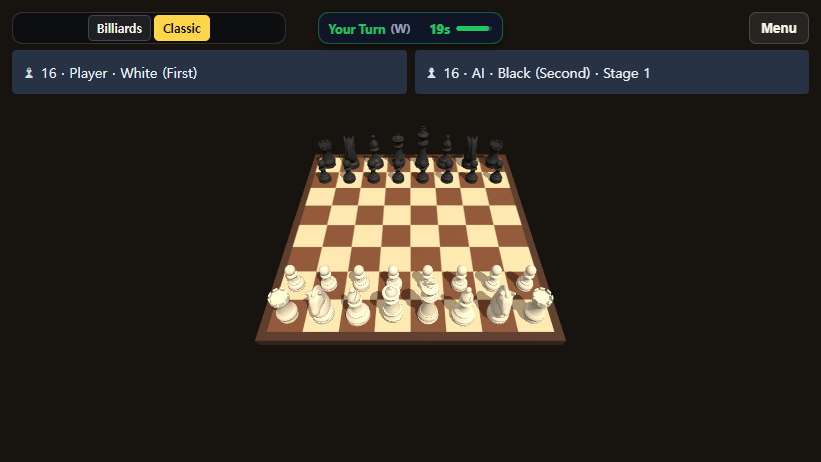
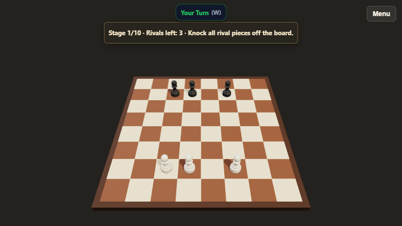
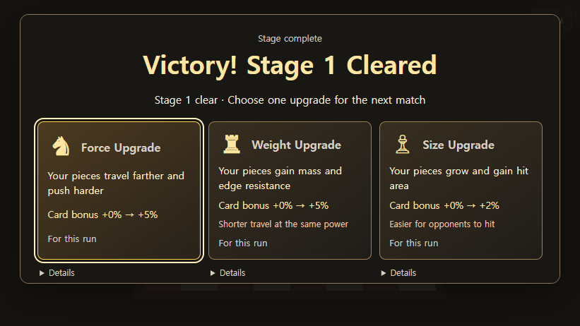

# CrazyGames solo opening trial — develop handoff

2026-11-09. 이번 변경은 CrazyGames 4차 재심사 기획의 **첫 3단계 시험본**이다. 재제출 준비 완료 또는 실제 포털 검증 완료로 해석하지 않는다.

## 적용 범위

- 신규 CG 게스트의 첫 샷 → 실제 장외 → 3대3 첫 경기 → 강화 → 다음 경기.
- 첫 세 단계의 3/4/4 기물 구성, 시간 제한과 승급 선택 제거, 목표/기물 대비/작은 화면 배치 개선.
- 실제 강화 보너스와 불이익 표시, 소유자별 브라우저 체크포인트, 저장소 차단/뒤늦은 용량 초과의 세션 메모리 처리.
- CG의 온라인/초대/매치메이킹 비활성화. 기존 계정 진행 연결과 일반 웹의 멀티플레이 경로 유지.
- 기존 연구/해금과 기초·심화 튜토리얼 100P 보상 경로 보존. 짧은 첫 샷 연습에는 별도 보상을 지급하지 않는다.

## 화면

| 변경 전 첫 경기 | 변경 후 첫 경기 |
|---|---|
|  |  |



## 검증 기록

- [자동 검사](verification.json): solo state/타이머/강화 표현/초기 물리/입력 취소/모의 RPC 진행 저장/게임플레이 회귀 통과.
- [최종 배포 파일 브라우저 검사](built-smoke.json): 실제 입력으로 첫 샷, 승리, 강화, 2단계, 재접속 복원. 초기 저장 거부와 한국어 로컬 iframe도 통과. Edge 157, DPR1, 합성 게스트 SDK이며 외부 HTTP/WS는 차단했다. 실제 포털/실제 계정 검증이 아니다.
- `npm run build:crazygames` 및 `npm run check:crazygames` 통과. 패키지 93파일 / 6,868,010바이트 / artifact findings 0.
- 검증 빌드 `1556bf4f0377-dirty-20261109061912`. ZIP SHA-256: `b288a9ae2ca7df5db4b0d584e3e254e98075c23005a2a226d3f387473860bbdf`.
- 빌드의 큰 JS 청크 경고는 남아 있다. 사람의 재미 평가, 저사양 기기 성능, Android 실기기 검사를 대신하지 않는다.

재현할 핵심 검사(프로젝트의 의존성을 설치한 뒤 `web`에서 실행):

```text
node src/tools/crazygames-solo-check.mjs
node src/tools/crazygames-opening-stage-check.mjs
node src/tools/crazygames-progression-check.mjs
node src/tools/classic-cancel-check.mjs
node src/tools/turn-timer-check.mjs
node src/tools/account-progress-check.mjs
node src/tools/gameplay-regression-check.mjs
npm run build:crazygames
npm run check:crazygames
```

CG 빌드는 기존 프로젝트의 Supabase 공개 설정이 필요하다. `.env`나 토큰은 이 커밋에 포함하지 않는다.

## 남은 게이트

신규 5명 무설명 검수 후 4~10단계 밸런스를 조정한다. 실제 포털의 로그인·계정 교체·클라우드 저장/다른 기기 복원, 지원 기기·주사율·청음 검수, 최종 신규 10명과 같은 빌드의 제출 미디어는 남아 있다. 로그인한 사용자의 시작은 아직 기존 계정 조회를 기다린다.

전체 로컬 보고서 `REPORT-ko.md`/`REVIEW.html`, ZIP, 상세 원본 캡처와 영상은 이 폴더의 로컬 산출물로 보관한다. 이 커밋은 소스·회귀 검사와 위의 작은 증거 묶음만 포함한다. 포털 제출이나 운영 배포는 수행하지 않는다.
